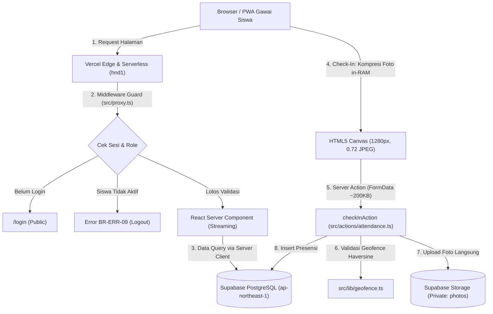
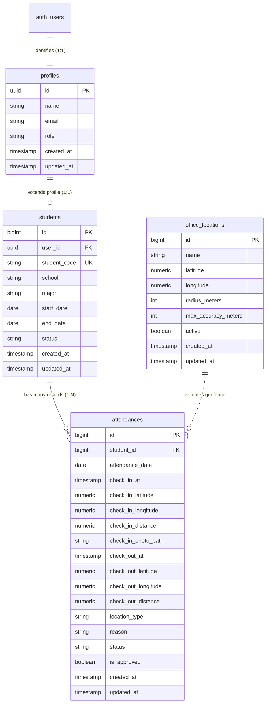
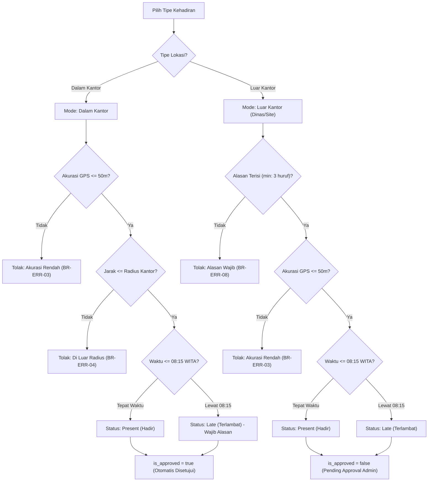
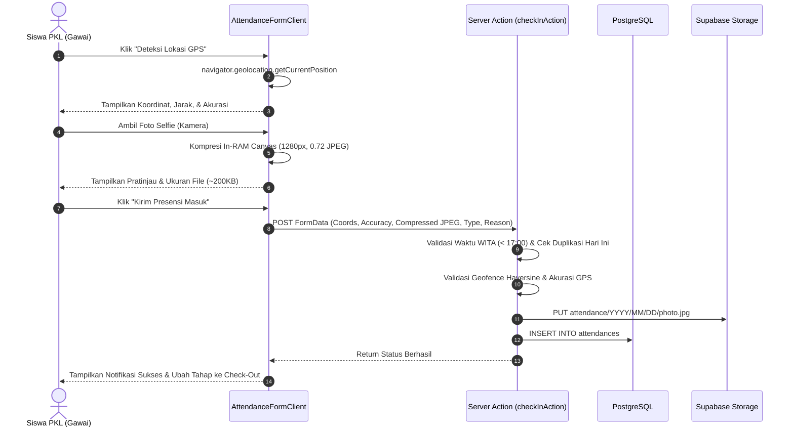

# Product Requirements Document (PRD) v3.0

# Sistem Presensi Peserta PKL Berbasis Web Geofencing, Next.js 16, Supabase, & Progressive Web App (PWA)

**Perusahaan Target:** PT Fiber Networks Indonesia (Fibernet) Branch Palu  
**Kategori Proyek:** Internal Operational Enterprise Web Application & PWA  
**Versi Dokumen:** 3.0 (Full Architecture Modernization Release)  
**Tanggal Rilis:** Oktober 2026  
**Status Implementasi:** Fully Implemented, Verified, & Production Ready  
**Tech Stack:** Next.js 16.4.3 (App Router, Turbopack, Server Actions), React 19.3.0, Tailwind CSS v4, @supabase/ssr, Supabase PostgreSQL, Row-Level Security (RLS), Supabase Private Storage, ExcelJS, Sonner, Vanilla Service Worker, Vercel Serverless  

---

## Daftar Isi
1. [Ringkasan Eksekutif](#1-ringkasan-eksekutif)
2. [Latar Belakang & Transformasi Arsitektur (v2.0 ke v3.0)](#2-latar-belakang--transformasi-arsitektur-v20-ke-v30)
3. [Tujuan Produk & Sasaran Strategis](#3-tujuan-produk--sasaran-strategis)
4. [Target Pengguna & Matriks Hak Akses (RBAC)](#4-target-pengguna--matriks-hak-akses-rbac)
5. [Arsitektur Teknis Sistem (Next.js + Supabase + Vercel)](#5-arsitektur-teknis-sistem-nextjs--supabase--vercel)
6. [Skema Basis Data, RLS, & Database Functions](#6-skema-basis-data-rls--database-functions)
7. [Entity Relationship Diagram (ERD)](#7-entity-relationship-diagram-erd)
8. [Konsep & Mekanisme Inti Geofencing (Haversine Formula)](#8-konsep--mekanisme-inti-geofencing-haversine-formula)
9. [Mekanisme Presensi Ganda (Dalam Kantor vs Luar Kantor)](#9-mekanisme-presensi-ganda-dalam-kantor-vs-luar-kantor)
10. [Aturan Waktu, Jam Server WITA, & Batas Keterlambatan](#10-aturan-waktu-jam-server-wita--batas-keterlambatan)
11. [Kompresi Foto In-RAM Browser (HTML5 Canvas Optimization)](#11-kompresi-foto-in-ram-browser-html5-canvas-optimization)
12. [Penyimpanan Bucket Privat & Streaming Foto Terotorisasi](#12-penyimpanan-bucket-privat--streaming-foto-terotorisasi)
13. [Sistem Loading Hibrida & Shimmer Skeleton (UI/UX)](#13-sistem-loading-hibrida--shimmer-skeleton-uiux)
14. [Sinkronisasi Absensi Otomatis (Automated Absentee Sync)](#14-sinkronisasi-absensi-otomatis-automated-absentee-sync)
15. [Modul Dashboard Streaming & Live Clock](#15-modul-dashboard-streaming--live-clock)
16. [Modul Presensi Siswa (Check-In & Check-Out)](#16-modul-presensi-siswa-check-in--check-out)
17. [Modul Laporan, Filter Normalisasi, & Export XLSX](#17-modul-laporan-filter-normalisasi--export-xlsx)
18. [Modul Manajemen Peserta PKL & Hapus Permanen 2 Tahap](#18-modul-manajemen-peserta-pkl--hapus-permanen-2-tahap)
19. [Modul Pengaturan (Profil, Keamanan, Geofence, & Storage)](#19-modul-pengaturan-profil-keamanan-geofence--storage)
20. [Progressive Web App (PWA) & Dukungan Offline](#20-progressive-web-app-pwa--dukungan-offline)
21. [Matriks Aturan Bisnis & Penanganan Error (BR-ERR-01 s/d BR-ERR-09)](#21-matriks-aturan-bisnis--penanganan-error-br-err-01-sd-br-err-09)
22. [Kebutuhan Non-Fungsional & Keamanan](#22-kebutuhan-non-fungsional--keamanan)
23. [Panduan Operasional & Penerapan Produksi (Deployment)](#23-panduan-operasional--penerapan-produksi-deployment)

---

## 1. Ringkasan Eksekutif

Sistem Presensi Peserta PKL Berbasis Web Geofencing PT Fiber Networks Indonesia (Fibernet) Branch Palu v3.0 adalah evolusi arsitektur penuh dari monolit PHP/Laravel menuju aplikasi web modern berbasis **Next.js 16 (App Router)**, **React 19**, **Supabase (PostgreSQL & Storage)**, dan di-hosting pada platform **Vercel Serverless**.

Aplikasi ini mengamankan pencatatan kehadiran peserta magang secara *real-time* dengan memadukan pembatasan lokasi GPS (Geofencing), verifikasi wajah instan tanpa membebani kuota, sinkronisasi otomatis status ketidakhadiran harian, otorisasi data multi-peran, dan laporan eksekutif berstandar industri.

Fitur kunci versi 3.0:
1. **Serverless Architecture & Ephemeral Execution:** Dirancang 100% tanpa ketergantungan pada disk lokal (*zero temporary files*), sepenuhnya kompatibel dengan infrastruktur komputasi edge dan serverless Vercel.
2. **Penyimpanan Terisolasi & Hemat Kuota:** Foto selfie dikompresi di memori RAM browser siswa (HTML5 Canvas) hingga ukuran 150–250 KB sebelum dikirim langsung ke private bucket Supabase Storage, mengeliminasi duplikasi file sementara.
3. **Hybrid Loading System:** Penggabungan Top Progress Bar + Badge Status untuk navigasi antar-halaman yang mulus tanpa kedip, didukung Skeleton Loading animasi *shimmer*, serta Fullscreen Blur Overlay untuk aksi sesi kritis (Login, Registrasi, Logout).
4. **Authoritative Server Timezone (WITA):** Penegakan waktu mutlak berbasis Waktu Indonesia Tengah (`Asia/Makassar`, UTC+8) menggunakan modul format waktu deterministik yang kebal terhadap zona waktu server Vercel (UTC).
5. **Keamanan Bertingkat & Row-Level Security (RLS):** Seluruh data tersimpan di PostgreSQL dengan kebijakan RLS ketat, token autentikasi berbasis cookie `httpOnly`, dan otorisasi foto privat via Route Handler khusus administrator.

---

## 2. Latar Belakang & Transformasi Arsitektur (v2.0 ke v3.0)

### 2.1 Masalah pada Arsitektur v2.0 (PHP/Laravel & VPS/Container)
- **Bottleneck Penyimpanan File Sementara (`livewire-tmp`):** Pengunggahan file selfie pada Livewire 3 sempat menyimpan file duplikat ke storage sebelum dipindahkan ke penyimpanan permanen.
- **Ketergantungan State Server:** Memerlukan server virtual (VM/Container Railway) yang menyala terus-menerus (*always-on*), meningkatkan biaya server bulanan dan risiko kehabisan memori (*memory leaks*).
- **Latensi Cold Start:** Proses rendering halaman pada framework monolit membutuhkan bootstrap seluruh modul framework untuk setiap *request*.

### 2.2 Solusi Terapan pada Arsitektur v3.0 (Next.js + Supabase + Vercel)
- **Komputasi Tanpa Server (Serverless Functions):** Kode hanya dieksekusi saat ada permintaan, menurunkan biaya infrastruktur hingga titik nol pada paket gratis (*hobby tier*).
- **Direct-to-Memory Upload:** Foto dari kamera ditangkap, di-*resize*, dikompresi menjadi format JPEG di memori gawai siswa, lalu dialirkan langsung ke Supabase Storage.
- **Region Co-location Rendah Latensi:** Serverless Function Vercel diposisikan pada kawasan **Tokyo (`hnd1`)** yang selaras dengan pusat data Supabase **Tokyo (`ap-northeast-1`)**, menghasilkan waktu respon query sangat cepat (`~15–30 ms`).
- **Dukungan Next.js 16 & React 19:** Pemanfaatan Server Components (RSC), Server Actions dengan validasi skema, dan transisi asinkron (`useActionState`, `useTransition`) untuk performa maksimal.

---

## 3. Tujuan Produk & Sasaran Strategis

1. **Integritas Lokasi 100%:** Memvalidasi secara matematis bahwa presensi "Dalam Kantor" benar-benar dilakukan di dalam radius kantor (default: 100 meter, akurasi GPS $\le$ 50 meter).
2. **Fleksibilitas Operasional Lapangan:** Menyediakan mode presensi "Luar Kantor" dengan kewajiban mengisi alasan dan memerlukan persetujuan administrator sebelum disahkan.
3. **Zero Maintenance Storage Overhead:** Menjaga pemakaian kuota storage Supabase di bawah 1 GB dengan pembersihan otomatis file yatim (*orphan files*) dan pembatasan resolusi foto.
4. **Pengalaman Pengguna Tanpa Hambatan:** Pemuatan instan melalui *streaming server rendering*, skeleton loading, dan integrasi PWA agar aplikasi dapat diakses seperti aplikasi ponsel *native*.
5. **Standarisasi Rekapitulasi Data:** Ekspor laporan presensi ke spreadsheet `.xlsx` dengan pewarnaan resmi perusahaan (Cyan `#0891B2`), format kolom baku, dan formula jam kerja yang tepat.

---

## 4. Target Pengguna & Matriks Hak Akses (RBAC)

Aplikasi memiliki dua peran utama: **`student`** (Peserta PKL) dan **`admin`** (Pembimbing Lapangan / HRD).

| Fitur / Halaman | Siswa (`student`) | Admin (`admin`) | Tamu (`guest`) |
| :--- | :---: | :---: | :---: |
| Halaman Login & Registrasi | Akses | Akses | Akses |
| Lupa / Reset Kata Sandi | Akses | Akses | Akses |
| Dashboard Siswa (Jam WITA & Riwayat Pribadi) | Akses | Dialihkan | Akses Ditolak |
| Dashboard Admin (Metrik Global & Live Timeline) | Akses Ditolak | Akses | Akses Ditolak |
| Form Presensi Check-In / Check-Out | Akses (Bila Aktif) | Akses Ditolak | Akses Ditolak |
| Rekap Laporan & Persetujuan (`/reports`) | Akses Ditolak | Akses | Akses Ditolak |
| Ekspor Laporan XLSX (`/api/reports/export`) | Akses Ditolak | Akses | Akses Ditolak |
| Aliran Foto Privat (`/api/reports/[id]/photo`) | Akses Ditolak | Akses | Akses Ditolak |
| Manajemen Peserta PKL (`/students`) | Akses Ditolak | Akses | Akses Ditolak |
| Hapus Permanen Siswa 2 Tahap | Akses Ditolak | Akses | Akses Ditolak |
| Pengaturan Lokasi Geofence (`/settings/geofence`) | Akses Ditolak | Akses | Akses Ditolak |
| Monitoring Storage (`/settings/storage`) | Akses Ditolak | Akses | Akses Ditolak |
| Pembersihan File Sampah Storage | Akses Ditolak | Akses | Akses Ditolak |
| Pengaturan Profil Mandiri (`/settings/profile`) | Akses | Akses | Akses Ditolak |
| Hapus Akun Mandiri (Kecuali Admin) | Akses | Ditolak | Akses Ditolak |
| Ubah Kata Sandi (`/settings/security`) | Akses | Akses | Akses Ditolak |

---

## 5. Arsitektur Teknis Sistem (Next.js + Supabase + Vercel)



### 5.1 Spesifikasi Komponen Inti
- **`src/proxy.ts` (Next.js Proxy / Middleware):** Menjaga sesi Supabase Auth, memperbarui token penyegaran (*refresh token*), memeriksa masa aktif siswa (`validateStudentActive`), dan mencegah akses lintas-peran.
- **`src/actions/*` (Server Actions):** Menangani mutasi data secara terisolasi di server dengan validasi tipe data mutlak (`auth.ts`, `attendance.ts`, `students.ts`, `settings.ts`).
- **`src/lib/time.ts`:** Modul waktu deterministik zona WITA (`Asia/Makassar`) untuk memotong jam presensi, menentukan hari kerja, dan mengalkulasi durasi waktu kerja.
- **`src/lib/geofence.ts`:** Algoritma Haversine berbasis parameter jari-jari bumi bulat untuk menghitung deviasi jarak meter antara gawai siswa dan titik kantor.

---

## 6. Skema Basis Data, RLS, & Database Functions

Basis data menggunakan PostgreSQL yang dikelola melalui Supabase dengan skema relasional terindeks penuh.

### 6.1 Tabel Utama

#### 1. `profiles`
Menyimpan data identitas umum pengguna yang terikat pada `auth.users`.
- `id` (UUID, Primary Key, References `auth.users(id)` ON DELETE CASCADE)
- `name` (TEXT, NOT NULL)
- `email` (TEXT, NOT NULL)
- `role` (TEXT, NOT NULL, CHECK `role IN ('admin', 'student')`, Default: `'student'`)
- `created_at` & `updated_at` (TIMESTAMPTZ, Default: `NOW()`)

#### 2. `students`
Menyimpan atribut khusus bagi peserta PKL/magang.
- `id` (BIGINT GENERATED ALWAYS AS IDENTITY, Primary Key)
- `user_id` (UUID, NOT NULL, UNIQUE, References `profiles(id)` ON DELETE CASCADE)
- `student_code` (TEXT, NOT NULL, UNIQUE) — NIM / NISN
- `school` (TEXT, NOT NULL) — Asal Sekolah / Universitas
- `major` (TEXT, NOT NULL) — Jurusan
- `start_date` (DATE, NOT NULL) — Tanggal mulai periode PKL
- `end_date` (DATE, NOT NULL) — Tanggal selesai periode PKL
- `status` (TEXT, NOT NULL, CHECK `status IN ('active', 'inactive')`, Default: `'active'`)
- `created_at` & `updated_at` (TIMESTAMPTZ, Default: `NOW()`)

#### 3. `office_locations`
Menyimpan koordinat geofencing kantor yang menjadi acuan kehadiran.
- `id` (BIGINT GENERATED ALWAYS AS IDENTITY, Primary Key)
- `name` (TEXT, NOT NULL) — Nama kantor
- `latitude` (NUMERIC(10, 7), NOT NULL)
- `longitude` (NUMERIC(10, 7), NOT NULL)
- `radius_meters` (INTEGER, NOT NULL, CHECK `radius_meters >= 10`, Default: `100`)
- `max_accuracy_meters` (INTEGER, NOT NULL, CHECK `max_accuracy_meters >= 5`, Default: `50`)
- `active` (BOOLEAN, NOT NULL, Default: `TRUE`)
- `created_at` & `updated_at` (TIMESTAMPTZ, Default: `NOW()`)

#### 4. `attendances`
Menyimpan transaksi presensi harian siswa.
- `id` (BIGINT GENERATED ALWAYS AS IDENTITY, Primary Key)
- `student_id` (BIGINT, NOT NULL, References `students(id)` ON DELETE CASCADE)
- `attendance_date` (DATE, NOT NULL)
- `check_in_at` (TIMESTAMPTZ, NULLABLE)
- `check_in_latitude` (NUMERIC(10, 7), NULLABLE)
- `check_in_longitude` (NUMERIC(10, 7), NULLABLE)
- `check_in_accuracy` (NUMERIC(8, 2), NULLABLE)
- `check_in_distance` (NUMERIC(8, 2), NULLABLE)
- `check_in_photo_path` (TEXT, NULLABLE)
- `check_out_at` (TIMESTAMPTZ, NULLABLE)
- `check_out_latitude` (NUMERIC(10, 7), NULLABLE)
- `check_out_longitude` (NUMERIC(10, 7), NULLABLE)
- `check_out_accuracy` (NUMERIC(8, 2), NULLABLE)
- `check_out_distance` (NUMERIC(8, 2), NULLABLE)
- `location_type` (TEXT, NOT NULL, CHECK `location_type IN ('inside', 'outside')`, Default: `'inside'`)
- `reason` (TEXT, NULLABLE)
- `status` (TEXT, NOT NULL, CHECK `status IN ('present', 'late', 'absent')`)
- `is_approved` (BOOLEAN, NULLABLE) — `true` = Disetujui, `false` = Pending Approval, `null` = Alpa / Otomatis
- `notes` (TEXT, NULLABLE)
- `created_at` & `updated_at` (TIMESTAMPTZ, Default: `NOW()`)
- *Unique Constraint:* `UNIQUE(student_id, attendance_date)`

### 6.2 Kebijakan Row-Level Security (RLS)
Setiap tabel mengaktifkan RLS (`ALTER TABLE ... ENABLE ROW LEVEL SECURITY`) dengan aturan:
- **`profiles`:** Pengguna dapat membaca dan memperbarui profil mereka sendiri; Admin memiliki akses baca ke seluruh profil.
- **`students`:** Siswa hanya dapat membaca profil siswa miliknya; Admin dapat membaca, membuat, memperbarui, dan menghapus seluruh data siswa.
- **`office_locations`:** Seluruh pengguna terautentikasi dapat membaca lokasi kantor aktif; Hanya Admin yang dapat mengubah lokasi geofence.
- **`attendances`:** Siswa dapat melihat riwayat absensi miliknya dan melakukan *insert/update* pada baris hari ini; Admin memiliki hak penuh (*full access*) untuk meninjau dan mengubah status persetujuan.

### 6.3 Database RPC: `get_bucket_storage_stats`
Fungsi PostgreSQL khusus untuk membaca metrik statistik bucket storage secara atomik:
```sql
CREATE OR REPLACE FUNCTION public.get_bucket_storage_stats(p_bucket TEXT)
RETURNS JSONB
LANGUAGE plpgsql
SECURITY DEFINER
AS $$
DECLARE
  v_total_bytes BIGINT := 0;
  v_total_files BIGINT := 0;
BEGIN
  SELECT
    COALESCE(SUM((metadata->>'size')::BIGINT), 0),
    COUNT(*)
  INTO v_total_bytes, v_total_files
  FROM storage.objects
  WHERE bucket_id = p_bucket;

  RETURN jsonb_build_object(
    'bucket', p_bucket,
    'total_bytes', v_total_bytes,
    'total_files', v_total_files
  );
END;
$$;
```

---

## 7. Entity Relationship Diagram (ERD)



---

## 8. Konsep & Mekanisme Inti Geofencing (Haversine Formula)

Sistem menggunakan formula trigonometri bola **Haversine** untuk menghitung jarak lingkaran besar (*great-circle distance*) antara koordinat GPS gawai siswa ($lat_1, lon_1$) dan titik acuan kantor PT Fiber Networks Indonesia Branch Palu ($lat_2, lon_2$).

### 8.1 Rumus Matematika
$$a = \sin^2\left(\frac{\Delta \phi}{2}\right) + \cos(\phi_1) \cdot \cos(\phi_2) \cdot \sin^2\left(\frac{\Delta \lambda}{2}\right)$$
$$c = 2 \cdot \text{atan2}\left(\sqrt{a}, \sqrt{1 - a}\right)$$
$$d = R \cdot c$$

Di mana:
- $\phi_1, \phi_2$ adalah garis lintang (*latitude*) dalam satuan radian.
- $\Delta \phi = (\text{lat}_2 - \text{lat}_1)$ dalam radian.
- $\Delta \lambda = (\text{lon}_2 - \text{lon}_1)$ dalam radian.
- $R$ adalah jari-jari rata-rata bumi: **$6.371.000$ meter**.
- $d$ adalah jarak dalam satuan meter, dibulatkan hingga 2 desimal (`round(d, 2)`).

### 8.2 Logika Validasi Geofence Server
1. **Pemeriksaan Akurasi GPS:** Jika `accuracy > office.max_accuracy_meters` (default `50m`), presensi ditolak dengan pesan `BR-ERR-03`.
2. **Pemeriksaan Jarak Geofence (Hanya mode Dalam Kantor):** Jika $d > \text{office.radius\_meters}$ (default `100m`), presensi ditolak dengan pesan `BR-ERR-04`.
3. **Bypass Jarak (Mode Luar Kantor):** Validasi jarak diabaikan jika `location_type === 'outside'`, namun nilai jarak tetap disimpan sebagai rekaman audit.

---

## 9. Mekanisme Presensi Ganda (Dalam Kantor vs Luar Kantor)

Sistem mengakomodasi dua skenario operasional lapangan:



---

## 10. Aturan Waktu, Jam Server WITA, & Batas Keterlambatan

Seluruh perhitungan waktu operasional dipusatkan pada modul [src/lib/time.ts](file:///c:/laragon/www/absensi-fibernet/src/lib/time.ts) dengan zona waktu resmi **WITA (`Asia/Makassar`, UTC+8)**:

| Parameter Waktu | Waktu WITA (UTC+8) | Ekivalen Server (UTC) | Dampak Bisnis |
| :--- | :---: | :---: | :--- |
| **Batas Waktu Tepat Waktu** | $\le$ 08:15:00 | $\le$ 00:15:00 UTC | Status presensi tercatat sebagai `present` (Hadir). |
| **Ambang Keterlambatan** | > 08:15:00 | > 00:15:00 UTC | Status presensi menjadi `late` (Terlambat), siswa **wajib** mengisi kolom keterangan/alasan (`min: 3` karakter). |
| **Batas Penutupan Presensi** | > 17:00:00 | > 09:00:00 UTC | Seluruh request *check-in* ditolak mutlak (`BR-ERR-05`). Siswa dianggap Alpa untuk hari tersebut. |
| **Batas Waktu Sinkronisasi Alpa** | $\ge$ 17:00:00 | $\ge$ 09:00:00 UTC | Hari kerja saat ini mulai diikutsertakan dalam pembentukan baris `absent` otomatis. |

---

## 11. Kompresi Foto In-RAM Browser (HTML5 Canvas Optimization)

Untuk memecahkan masalah kehabisan kuota storage dan kegagalan upload pada jaringan seluler 3G/4G yang tidak stabil di Palu, pengambilan foto check-in menerapkan pemrosesan citra langsung di memori gawai siswa sebelum request HTTP dikirimkan.

### 11.1 Alur Teknis Kompresi
1. Gawai menangkap citra kamera beresolusi tinggi (biasanya 12–48 Megapixel, ukuran 4–12 MB).
2. Browser memuat citra ke elemen `Image` dalam memori RAM (tanpa menyentuh filesystem).
3. Algoritma menghitung rasio aspek dengan batas dimensi maksimum **$1280 \times 1280$ piksel**:
   $$\text{skala} = \min\left(1, \frac{1280}{\max(\text{lebar}, \text{tinggi})}\right)$$
4. Citra digambar ulang ke dalam `<canvas>` dengan dimensi baru.
5. Canvas diekspor ke objek `Blob` berkode MIME `image/jpeg` dengan tingkat kualitas kompresi **`0.72`**.
6. Citra akhir berukuran rata-rata **$150\text{ KB} - 250\text{ KB}$** (efisiensi $\approx 95\%$) dibungkus ke dalam `FormData` dan dikirim via Server Action.

---

## 12. Penyimpanan Bucket Privat & Streaming Foto Terotorisasi

Bucket Supabase Storage **`photos`** dikonfigurasi sebagai bucket privat (`public = false`) demi melindungi privasi biometrik wajah siswa PKL.

### 12.1 Struktur Jalur File
Foto check-in disimpan secara terstruktur berdasarkan tanggal dan ID siswa:
$$\text{attendance}/YYYY/MM/DD/\text{student\_}\{id\}\_\text{checkin\_}\{\text{timestamp}\}.jpg$$
*Contoh:* `attendance/2026/10/30/student_4_checkin_1793345812.jpg`

### 12.2 Aliran Foto Terotorisasi (`/api/reports/[id]/photo`)
- URL langsung ke Supabase Storage tidak pernah diekspos ke publik atau klien.
- Halaman detail admin menampilkan foto melalui endpoint Route Handler:
  `GET /api/reports/[id]/photo`
- **Mekanisme Keamanan:**
  1. Route Handler memvalidasi sesi cookie pengguna.
  2. Memeriksa peran pengguna; jika `role !== 'admin'`, me-return `403 Forbidden`.
  3. Mengambil `check_in_photo_path` dari tabel `attendances` berdasarkan ID laporan.
  4. Server mengunduh stream biner dari Supabase Storage menggunakan kredensial privat (`SUPABASE_SECRET_KEY`) dan mengalirkannya kembali ke browser dengan header `Content-Type: image/jpeg` dan `Cache-Control: private, no-transform`.

---

## 13. Sistem Loading Hibrida & Shimmer Skeleton (UI/UX)

Sistem mengadopsi pola pemuatan dua tingkat (*Hybrid Loading*) untuk mengoptimalkan kenyamanan interaksi:

### 13.1 Pemuatan Navigasi (Top Progress Bar + Badge Kapsul + Skeleton)
- **Konteks:** Berpindah antar menu (`Dashboard` $\rightarrow$ `Reports` $\rightarrow$ `Peserta PKL` $\rightarrow$ `Settings`) atau mengubah filter laporan.
- **Tampilan:**
  - Garis tipis Cyan (`#0891B2`) bergerak di paling atas layar dengan interval *trickle*.
  - Badge kapsul mengambang dengan spinner kecil bertuliskan `"Memuat halaman..."`.
  - Area konten menampilkan layout **Shimmer Skeleton** (`.fibernet-shimmer`) yang menyapu dari kiri ke kanan.
- **Keunggulan UX:** Layar tidak berkedip (*no flicker*), pengguna tetap dapat melihat layout halaman sebelumnya selagi data baru dialirkan (*streaming*).

### 13.2 Pemuatan Aksi Sesi Kritis (Fullscreen Blur Overlay)
- **Konteks:** Form dengan konsekuensi sesi atau transaksi berat:
  - Login: `"Sedang masuk..."`
  - Registrasi: `"Mendaftarkan akun..."`
  - Lupa / Reset Password: `"Memproses kata sandi..."`
  - Logout: `"Sedang keluar..."`
- **Tampilan:** Seluruh layar ditutup lapisan latar belakang semi-transparan redup (*backdrop blur*), scroll body dikunci, dan kartu spinner putih muncul di tengah layar.
- **Keunggulan UX:** Mengunci seluruh tombol dan input gawai secara fisik untuk mencegah *double submit* saat jaringan seluler sedang lambat.

---

## 14. Sinkronisasi Absensi Otomatis (Automated Absentee Sync)

Sistem tidak mewajibkan *cron job* eksternal yang rumit untuk mencatat siswa yang tidak masuk. Sinkronisasi dieksekusi secara otomatis (*lazy synchronization*) melalui modul [src/lib/sync-absentees.ts](file:///c:/laragon/www/absensi-fibernet/src/lib/sync-absentees.ts) setiap kali Administrator membuka menu Laporan (`/reports`) atau mengunduh Excel:

### 14.1 Logika Perhitungan Hari Alpa
1. Mengambil seluruh siswa dengan status `active`.
2. Menghitung rentang tanggal yang memenuhi syarat absensi:
   - Mulai dari $\max(\text{start\_date}, \text{awal bulan})$.
   - Sampai dengan $\min(\text{end\_date}, \text{hari ini})$.
   - **Filter Hari:** Melewatkan hari Sabtu dan Minggu (hanya Senin–Jumat).
   - **Filter Jam:** Melewatkan hari ini jika waktu WITA saat itu masih **$< 17:00$**.
3. Memeriksa keberadaan data absensi pada tabel `attendances`.
4. Untuk setiap tanggal yang belum memiliki presensi, sistem melakukan operasi *bulk upsert ignore*:
   - `status = 'absent'`
   - `is_approved = null` (ditandai `null` agar tidak tampil sebagai antrean *Pending Approval*)
   - `location_type = 'inside'`

---

## 15. Modul Dashboard Streaming & Live Clock

### 15.1 Dashboard Peserta PKL (`role = 'student'`)
- **Jam Digital Real-time WITA (`LiveClock`):** Menampilkan jam, menit, dan detik dalam zona waktu Palu dengan interval pembaruan 1.000 ms.
- **Status Periode PKL:** Menampilkan asal instansi, jurusan, sisa masa aktif hari, serta progress bar persentase masa magang yang telah dilalui.
- **Kartu Aksi Hari Ini:** Menampilkan status kehadiran hari ini (Belum Absen / Sudah Check-In / Selesai Check-Out).
- **Riwayat Singkat:** Tabel 5 kehadiran terakhir beserta status persetujuan.

### 15.2 Dashboard Administrator (`role = 'admin'`)
- **Metrik Utama (Stat Cards):**
  - Total Peserta PKL Aktif
  - Hadir Hari Ini (Tepat Waktu)
  - Terlambat Hari Ini
  - Luar Kantor / Menunggu Persetujuan
- **Live Feed Presensi Harian:** Linimasa vertikal (*timeline connector*) yang mencantumkan nama siswa, instansi, jam check-in/out, jenis lokasi, serta tautan cepat ke verifikasi laporan.

---

## 16. Modul Presensi Siswa (Check-In & Check-Out)

Tersedia pada halaman `/attendance` khusus peran siswa aktif.



---

## 17. Modul Laporan, Filter Normalisasi, & Export XLSX

Halaman `/reports` dirancang untuk pengawasan dan audit kehadiran oleh Admin.

### 17.1 Filter Cerdas & Normalisasi Nama Sekolah
- Menampilkan filter tanggal awal, tanggal akhir, nama siswa, status absensi, dan instansi.
- **Deduplikasi Sekolah:** Mengeliminasi perbedaan huruf besar-kecil dan spasi berlebih pada nama sekolah/kampus secara *case-insensitive* (`trim().toLowerCase()`), sehingga nama seperti "SMKN 3 Palu" dan "smkn 3 palu" digabungkan dalam satu opsi dropdown.
- **SPA Soft-Navigation:** Formulir filter menggunakan komponen Next.js Form (`next/form`) untuk navigasi klien mulus tanpa *full-page reload*.

### 17.2 Export Excel Berstandar Industri (`/api/reports/export`)
Dihasilkan secara dinamis di memori serverless menggunakan pustaka `exceljs`:
- **Format File:** `rekap-presensi-{sekolah}-{tanggal-mulai}-to-{tanggal-selesai}.xlsx`
- **Tampilan Header:** Berwarna **Cyan 600 (`#FF0891B2`)**, teks tebal berwarna putih, tinggi baris 28 pt, vertikal-horizontal *center aligned*.
- **Kolom Data (10 Kolom):**
  1. `NIM/NISN`
  2. `Nama Peserta`
  3. `Sekolah/Kampus`
  4. `Tanggal` (Format: `DD/MM/YYYY`)
  5. `Check In` (Jam WITA)
  6. `Check Out` (Jam WITA)
  7. `Jenis Presensi` (Dalam Kantor / Luar Kantor)
  8. `Status` (Hadir / Terlambat / Alpa)
  9. `Jarak (m)`
  10. `Akurasi GPS (m)`
- **Auto-Width Column:** Lebar kolom disesuaikan otomatis mengikuti panjang teks data maksimum dengan padding aman 4 karakter.

---

## 18. Modul Manajemen Peserta PKL & Hapus Permanen 2 Tahap

Halaman `/students` menyediakan kendali penuh atas data dan akun siswa magang.

### 18.1 Modal Edit Siswa
Administrator dapat memperpanjang masa magang dengan mengubah `Tanggal Selesai`, mengubah `Tanggal Mulai`, atau menonaktifkan akun (`status: 'inactive'`).

### 18.2 Modal Hapus Permanen 2 Tahap (*Two-Step Deletion*)
Untuk mencegah penghapusan data fatal secara tidak sengaja:
- **Tahap 1 (Audit Dampak):** Menampilkan ringkasan komprehensif: nama siswa, instansi, jumlah total baris absensi, dan jumlah file foto di Supabase Storage yang akan musnah selamanya.
- **Tahap 2 (Konfirmasi Eksplisit):** Mengharuskan Administrator mengetik ulang kode **NIM/NISN** siswa secara persis ke dalam kotak input. Tombol "Hapus Permanen" tetap terkunci (*disabled*) hingga input cocok 100%.
- **Eksekusi Server Transaksional:**
  1. Menghapus seluruh file foto siswa dari Supabase Storage.
  2. Memanggil `supabaseAdmin.auth.admin.deleteUser(userId)`, yang secara otomatis menghapus baris profil, data siswa, dan riwayat absensi secara kaskade (`CASCADE`).
  3. Membatalkan cache metrik penyimpanan (`revalidateTag('storage-stats')`).

---

## 19. Modul Pengaturan (Profil, Keamanan, Geofence, & Storage)

### 19.1 Profil (`/settings/profile`)
- Pembaruan nama, alamat email, dan data akademis siswa (NIM, Asal Sekolah, Jurusan).
- **Hapus Akun Mandiri:** Siswa dapat menghapus akunnya sendiri setelah memverifikasi kata sandi aktif saat ini (Akun peran Administrator dilindungi dan tidak dapat dihapus melalui fitur ini).

### 19.2 Keamanan (`/settings/security`)
Pembaruan kata sandi akun dengan validasi kata sandi lama secara aman menggunakan `signInWithPassword` sebelum pembaruan kata sandi baru diterima.

### 19.3 Geofence Dinamis (`/settings/geofence` - Khusus Admin)
Formulir konfigurasi titik presensi kantor:
- Nama Kantor Acuan
- Titik Latitude & Longitude
- Radius Geofence (Minimal 10 meter)
- Batas Maksimum Toleransi Akurasi GPS (Minimal 5 meter)
- Sakelar Status Aktif (*Active Toggle*)

### 19.4 Monitoring Penyimpanan Cloud (`/settings/storage` - Khusus Admin)
Menyajikan panel pemantauan kuota penyimpanan Supabase Storage secara *real-time*:
- **Cache Berjangka 10 Menit:** Menggunakan `unstable_cache` bertag `'storage-stats'` untuk menghemat kuota pembacaan API Supabase.
- **Rincian Data:**
  - **Foto Presensi Aktif:** Jumlah & ukuran foto yang terhubung resmi pada data absensi.
  - **File Sementara (`livewire-tmp/`):** Deteksi file sampah sisa arsitektur lama.
  - **Foto Yatim (*Orphan Files*):** File foto di bucket yang datanya sudah terhapus dari tabel database.
- **Pembersihan File Sampah:** Tombol aksi dengan modal konfirmasi dan pengaman usia file: hanya menghapus file sampah yang berusia **$> 15$ menit** untuk menghindari bentrok dengan proses unggah yang sedang aktif.

---

## 20. Progressive Web App (PWA) & Dukungan Offline

Aplikasi memenuhi seluruh kriteria kelayakan PWA modern:
- **`public/manifest.json`:** Mengatur nama aplikasi, warna tema Cyan (`#0891B2`), mode display `standalone`, dan ikon resolusi tinggi.
- **`public/sw.js` (Service Worker):**
  - Mengelola *caching* aset statis inti (CSS, gambar logo, fonts, script).
  - Melindungi rute data privat: mengecualikan rute dinamis `/api/*`, Server Actions, dan RSC dari cache untuk mencegah data basi.
  - Header respon diatur ke `Cache-Control: public, max-age=0, must-revalidate` melalui [vercel.json](file:///c:/laragon/www/absensi-fibernet/vercel.json) agar pembaruan service worker langsung diterapkan oleh browser.
- **Halaman Offline Fallback (`/offline`):** Jika gawai kehilangan sinyal internet total saat membuka halaman baru, aplikasi otomatis mengalihkan ke halaman `/offline` yang ramah pengguna dengan tombol "Coba Muat Ulang".

---

## 21. Matriks Aturan Bisnis & Penanganan Error (BR-ERR-01 s/d BR-ERR-09)

Seluruh pesan penolakan dan validasi sistem dikunci secara kata-demi-kata (*verbatim*) sesuai standar operasional PT Fiber Networks Indonesia Branch Palu:

| Kode Aturan | Pemicu Kondisi Error | Pesan Error Resmi (*Verbatim*) |
| :--- | :--- | :--- |
| **BR-ERR-01** | Pengguna menolak izin akses GPS browser (Error code `1`). | `"Akses lokasi ditolak. Harap izinkan akses lokasi di browser Anda."` |
| **BR-ERR-02** | GPS perangkat tidak aktif / hardware error (Error code `2`). | `"Lokasi tidak tersedia (GPS tidak aktif)."` *(Timeout: `"Waktu permintaan lokasi habis."`)* |
| **BR-ERR-03** | Nilai akurasi GPS gawai melebihi batas `max_accuracy_meters`. | `"Akurasi lokasi terlalu rendah ({accuracy}m). Maksimal yang diizinkan adalah {max}m. Coba aktifkan GPS dan ulangi."` |
| **BR-ERR-04** | Jarak siswa melebihi radius kantor pada mode Dalam Kantor. | `"Anda berada di luar area presensi. Jarak Anda {distance}m dari kantor (Maks: {radius}m)."` |
| **BR-ERR-05** | Siswa mencoba check-in setelah pukul 17:00:00 WITA. | `"Batas waktu presensi hari ini telah berakhir (Pukul 17:00). Anda tercatat sebagai Alpa/Tidak Hadir."` |
| **BR-ERR-06** | Siswa mencoba check-in lebih dari satu kali di hari yang sama. | `"Anda sudah melakukan check-in hari ini."` |
| **BR-ERR-07** | Siswa mencoba check-out sebelum check-in, atau check-out 2x. | `"Anda belum melakukan check-in hari ini."` *(Jika sudah check-out: `"Anda sudah melakukan check-out hari ini."`)* |
| **BR-ERR-08** | Kolom keterangan kosong saat memilih Luar Kantor atau terlambat. | `"Keterangan/Alasan wajib diisi (karena Anda memilih Luar Kantor atau terlambat)."` |
| **BR-ERR-09** | Siswa nonaktif atau masa magang PKL telah berakhir: |  |
|  | - Data profil siswa tidak ditemukan di database. | `"Data siswa tidak ditemukan."` |
|  | - Kolom `status` bernilai `'inactive'`. | `"Akun PKL Anda telah dinonaktifkan."` |
|  | - Waktu saat ini melewati batas akhir tanggal `end_date`. | `"Masa PKL Anda telah berakhir pada {dd MMM YYYY}. Hubungi Admin untuk perpanjangan."` |
| **BR-ERR-10** | Titik lokasi kantor aktif tidak ditemukan di database. | `"Lokasi kantor aktif tidak ditemukan."` |

---

## 22. Kebutuhan Non-Fungsional & Keamanan

### 22.1 Keamanan Data & Otorisasi
1. **Pemisahan Kunci Kredensial:**
   - `NEXT_PUBLIC_SUPABASE_PUBLISHABLE_KEY`: Kunci publik yang hanya memiliki hak akses sesuai RLS.
   - `SUPABASE_SECRET_KEY`: Kunci rahasia tingkat tinggi (*Service Role*) yang diproteksi dengan deklarasi `import "server-only"`, **tidak boleh dan tidak pernah diekspos** ke bundle JavaScript klien.
2. **Perlindungan Session Cookie:** Token otentikasi disimpan dalam cookie dengan atribut `HttpOnly`, `SameSite=Lax`, dan `Secure` pada mode HTTPS.
3. **Pencegahan Double-Request:** Formulir mengunci tombol submit secara fisik (`disabled = true`) saat proses request pertama sedang dikirimkan untuk mencegah rekaman ganda.

### 22.2 Kinerja & Efisiensi
1. **Ukuran Bundle Ringan:** Memanfaatkan Tailwind CSS v4 dengan engine kompilasi berbasis Rust/Turbopack, menghasilkan berkas CSS produksi yang sangat ramping.
2. **Core Web Vitals:** Pemuatan font lokal via `next/font/google` (`Instrument_Sans`) dengan strategi *zero layout shift* (`display: swap`).
3. **Serverless Cache Management:** Statistik pemakaian storage dibungkus cache 10 menit untuk menghindari pembengkakan panggilan API ke Supabase.

---

## 23. Panduan Operasional & Penerapan Produksi (Deployment)

### 23.1 Konfigurasi Environment Variables (Vercel & `.env.local`)
```env
# Aplikasi & Zona Waktu
NEXT_PUBLIC_APP_NAME="Presensi PKL Fibernet"
NEXT_PUBLIC_APP_URL="https://absensi-fibernet.vercel.app"
APP_TIMEZONE="Asia/Makassar"

# Supabase API (Dashboard -> Project Settings -> API)
NEXT_PUBLIC_SUPABASE_URL="https://<project-ref>.supabase.co"
NEXT_PUBLIC_SUPABASE_PUBLISHABLE_KEY="sb_publishable_..."
SUPABASE_SECRET_KEY="sb_secret_..."

# Supabase Storage & Quota
SUPABASE_STORAGE_BUCKET="photos"
STORAGE_QUOTA_MB="1024"
```

### 23.2 Konfigurasi `vercel.json`
```json
{
  "$schema": "https://openapi.vercel.sh/vercel.json",
  "framework": "nextjs",
  "regions": ["hnd1"],
  "headers": [
    {
      "source": "/sw.js",
      "headers": [
        {
          "key": "Cache-Control",
          "value": "public, max-age=0, must-revalidate"
        },
        {
          "key": "Service-Worker-Allowed",
          "value": "/"
        }
      ]
    }
  ]
}
```

### 23.3 Langkah Penerapan (*Deployment Steps*)
1. Pastikan seluruh perubahan kode telah di-commit ke branch `main` pada repositori Git (`HQID/absensi-fibernet`).
2. Buat proyek baru di **Vercel** dengan mengimpor repositori tersebut (pilih *Root Directory:* `./`).
3. Masukkan seluruh variabel lingkungan pada menu *Settings $\rightarrow$ Environment Variables*.
4. Pada **Supabase Dashboard $\rightarrow$ Authentication $\rightarrow$ URL Configuration**:
   - Isi **Site URL** dengan domain Vercel Anda (`https://<domain>.vercel.app`).
   - Daftarkan **Redirect URLs**: `https://<domain>.vercel.app/api/auth/callback**`.
5. Jalankan proses deploy Vercel; aplikasi siap digunakan secara operasional oleh seluruh siswa dan staf administrator PT Fiber Networks Indonesia Branch Palu.

---

*Dokumen PRD v3.0 ini disahkan sebagai spesifikasi teknis dan acuan operasional mutlak Sistem Presensi PKL PT Fiber Networks Indonesia Branch Palu.*
