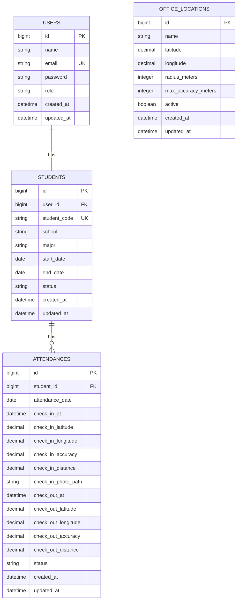

# Product Requirements Document (PRD)

# Sistem Presensi Peserta PKL Berbasis Web dengan Geofencing

**Target:** PT Fiber Networks Indonesia Branch Palu  
**Project Type:** Web-based prototype / internal operational prototype  
**Framework:** Laravel  
**Data:** Dummy untuk tahap KP  
**Deployment MVP:** Local server / local network  
**Status:** Prototype

---

## 1. Ringkasan Produk

Sistem ini merupakan aplikasi web untuk mengotomatisasi proses presensi peserta PKL yang saat ini dilakukan menggunakan foto dari aplikasi camera timestamp kemudian dikirim ke grup WhatsApp.

Sistem menggantikan alur tersebut dengan mekanisme:

```text
Login
  ↓
Check In / Check Out
  ↓
Ambil lokasi perangkat
  ↓
Validasi GPS accuracy
  ↓
Validasi geofence
  ↓
Ambil foto check-in
  ↓
Simpan presensi
  ↓
Dashboard & rekap otomatis
```

Fokus MVP hanya pada **presensi**. Fitur aktivitas harian, jurnal PKL, evaluasi, dan fungsi manajemen PKL lainnya tidak termasuk dalam MVP.

---

## 2. Latar Belakang

Saat ini peserta PKL menggunakan aplikasi camera timestamp untuk mengambil bukti kehadiran, kemudian foto dikirimkan ke grup WhatsApp. Proses tersebut menyebabkan bukti presensi tersebar di percakapan, sulit direkap, sulit dicari kembali, dan masih membutuhkan pekerjaan manual dari pihak pembimbing/manager.

Sistem yang dikembangkan bertujuan membuat proses presensi lebih terstruktur dengan menyimpan data presensi, waktu server, bukti foto, dan informasi lokasi dalam satu sistem.

Fitur pembeda utama adalah **geofencing berbasis browser geolocation** sehingga peserta hanya dapat melakukan presensi ketika berada dalam area yang telah ditentukan oleh perusahaan.

---

# 3. Tujuan

## 3.1 Tujuan Utama

Mengembangkan sistem presensi peserta PKL berbasis web dengan verifikasi lokasi untuk membantu otomatisasi dan pengelolaan data kehadiran.

## 3.2 Tujuan Khusus

Sistem harus dapat:

1. Mengelola akun peserta PKL.
2. Melakukan check-in dan check-out.
3. Mengambil lokasi pengguna melalui browser geolocation.
4. Memvalidasi akurasi lokasi.
5. Memvalidasi posisi pengguna terhadap geofence kantor.
6. Menyimpan bukti foto check-in.
7. Menggunakan server timestamp sebagai waktu presensi resmi.
8. Menentukan status kehadiran secara otomatis.
9. Menampilkan riwayat presensi.
10. Menyediakan dashboard untuk admin/manager.
11. Menyediakan export data presensi.

---

# 4. Scope MVP

## 4.1 Fitur Wajib

### Peserta PKL

- Login.
- Melihat status presensi hari ini.
- Check-in.
- Check-out.
- Mengambil lokasi perangkat.
- Melihat hasil verifikasi lokasi.
- Mengambil/mengunggah foto check-in.
- Melihat riwayat presensi pribadi.

### Admin/Manager

- Login.
- Melihat dashboard presensi.
- Melihat daftar peserta PKL.
- Melihat data presensi.
- Melihat detail presensi.
- Melihat bukti foto.
- Melihat informasi lokasi presensi.
- Melihat jarak dari geofence.
- Melihat GPS accuracy.
- Export rekap presensi.

### Sistem

- Server timestamp.
- Geofencing.
- GPS accuracy validation.
- Automatic attendance status.
- Local database.
- Local photo storage.

---

# 5. Non-Goals

MVP tidak mencakup:

- Activity log harian.
- Jurnal PKL.
- Evaluasi peserta.
- Face recognition.
- Face matching.
- QR code sebagai requirement utama.
- WhatsApp API.
- Mobile native application.
- Cloud storage.
- Multi-branch management.
- Integrasi dashboard perusahaan.
- Integrasi MikroTik.
- Integrasi Winbox.
- API jaringan.
- Push notification.
- AI/ML.
- Advanced attendance analytics.

Fitur tersebut dapat dipertimbangkan pada pengembangan berikutnya.

---

# 6. Target User

## 6.1 Peserta PKL

Kemampuan:

- Login.
- Check-in.
- Check-out.
- Menggunakan geolocation.
- Mengambil foto check-in.
- Melihat riwayat presensi.

## 6.2 Admin / Manager

Kemampuan:

- Login.
- Melihat dashboard.
- Mengelola peserta.
- Melihat presensi seluruh peserta.
- Melihat detail presensi.
- Melihat bukti foto.
- Melakukan export laporan.
- Mengatur lokasi kantor dan parameter geofence jika hak akses diberikan.

---

# 7. Konsep Geofencing

Geofencing merupakan fitur inti sistem.

Sistem memiliki konfigurasi lokasi kantor:

```text
Office Location
├── Latitude
├── Longitude
├── Radius (meter)
└── Maximum GPS Accuracy (meter)
```

Contoh dummy:

```text
Latitude  : -0.xxxxx
Longitude : 119.xxxxx
Radius    : 100 m
Max GPS Accuracy : 50 m
```

Saat peserta melakukan presensi, browser meminta lokasi perangkat.

Data yang dikirim:

```text
latitude
longitude
accuracy
```

Server kemudian menghitung:

```text
Distance = Haversine(Student Location, Office Location)
```

Presensi hanya diperbolehkan apabila:

```text
Distance <= Geofence Radius
AND
GPS Accuracy <= Maximum GPS Accuracy
```

---

# 8. Geofence Validation Flow

```text
Student clicks Check In
        ↓
Request browser geolocation
        ↓
Receive latitude, longitude, accuracy
        ↓
Send data to Laravel
        ↓
Validate GPS accuracy
        ↓
Calculate distance to office
        ↓
Is location valid?
     ┌──┴──┐
    NO    YES
     │      │
     ▼      ▼
 Reject   Continue
            ↓
       Take Photo
            ↓
       Save Attendance
```

---

# 9. GPS Accuracy Requirement

Sistem **tidak boleh hanya memeriksa jarak**.

Contoh:

```text
Distance = 35 m
Accuracy = 180 m
```

Meskipun jarak terlihat berada dalam radius, kualitas lokasi terlalu rendah. Sistem harus menolak atau meminta pengguna mengambil lokasi ulang.

Contoh pesan:

> Akurasi lokasi terlalu rendah (180 m). Aktifkan GPS dan coba kembali.

Target default prototype:

```text
Maximum GPS Accuracy = 50 m
```

Nilai ini dapat dikonfigurasi.

---

# 10. Presensi Check-In

Flow:

```text
Login
  ↓
Open Attendance
  ↓
Check In
  ↓
Request Location
  ↓
Validate Accuracy
  ↓
Validate Geofence
  ↓
Take Photo
  ↓
Preview Photo
  ↓
Submit
  ↓
Server Timestamp
  ↓
Save Attendance
```

Data yang dicatat:

- student_id
- tanggal
- waktu server
- latitude
- longitude
- GPS accuracy
- distance to office
- photo path
- status

---

# 11. Presensi Check-Out

Check-out juga menggunakan geofencing.

Flow:

```text
Check Out
  ↓
Request Location
  ↓
Validate Accuracy
  ↓
Validate Geofence
  ↓
Record Server Timestamp
```

Untuk MVP, **foto hanya diperlukan saat check-in** agar penggunaan storage lebih hemat.

---

# 12. Server Timestamp

Waktu presensi harus menggunakan waktu server aplikasi.

Sistem tidak boleh menggunakan waktu yang dikirim oleh perangkat sebagai sumber waktu utama.

Contoh:

```text
Server Check-in:
2026-09-15 08:03:12
```

Hal ini mencegah pengguna memanipulasi waktu perangkat.

---

# 13. Attendance Status

Status otomatis ditentukan berdasarkan waktu check-in dan jadwal yang telah ditentukan.

Contoh konfigurasi dummy:

```text
<= 08:00      → Present
> 08:00       → Late
No check-in   → Absent
```

Batas waktu harus configurable dan tidak hard-code apabila memungkinkan.

Status:

```text
present
late
absent
```

Optional:

```text
on_leave
```

jika dibutuhkan nanti.

---

# 14. Attendance Dashboard

Dashboard admin/manager minimal menampilkan:

```text
Total Students
Present
Late
Absent
```

Contoh:

```text
┌─────────────────────────────────────────┐
│          ATTENDANCE DASHBOARD            │
├─────────────────────────────────────────┤
│                                         │
│ Students   Present   Late   Absent      │
│    12         9       2       1        │
│                                         │
└─────────────────────────────────────────┘
```

Daftar hari ini:

```text
Student A     07:58     Present
Student B     08:03     Late
Student C     08:07     Late
Student D     -         Absent
```

---

# 15. Attendance Detail

Admin/manager dapat membuka satu record presensi.

Informasi:

```text
Student       : PKL-001
Date          : 15 Sep 2026
Check In      : 08:03:12
Check Out     : 17:02:43
Status        : Late

Location
Latitude     : ...
Longitude    : ...
Distance     : 43 m
GPS Accuracy : 14 m

Photo
[ View Photo ]
```

Ini menjadi audit trail sederhana dari presensi.

---

# 16. Attendance History

Peserta dapat melihat riwayat pribadi.

Contoh:

| Date | Check In | Check Out | Status |
|---|---|---|---|
| 15/09/2026 | 08:03 | 17:02 | Late |
| 14/09/2026 | 07:57 | 17:01 | Present |
| 13/09/2026 | - | - | Absent |

Admin dapat melihat seluruh peserta.

---

# 17. Photo Evidence

Foto berfungsi sebagai bukti presensi.

Foto tidak disimpan sebagai binary/blob di database.

Arsitektur:

```text
Laravel
├── Database
│   └── photo_path
│
└── File Storage
    └── attendance/
        └── YYYY/MM/DD/
            └── student_checkin.webp
```

Database hanya menyimpan metadata/path.

---

# 18. Photo Compression

Foto perlu dikompresi sebelum disimpan.

Target prototype:

- maksimal sisi terpanjang sekitar 1280 px;
- gunakan JPEG/WebP;
- quality sekitar 70–80%;
- target ukuran sekitar 200–500 KB per foto apabila memungkinkan.

Foto original dari kamera tidak boleh langsung digunakan sebagai storage permanen apabila dapat dikompresi.

---

# 19. Privacy

Foto peserta merupakan data pribadi dan harus dilindungi.

Requirements:

- Foto tidak boleh public.
- Foto hanya dapat diakses oleh pengguna berwenang.
- Jangan menyimpan foto menggunakan URL public tanpa authorization.
- Jangan menyimpan data pelanggan perusahaan.
- Gunakan data dummy pada tahap KP.
- Jangan menyimpan credential produksi.

---

# 20. Local Deployment MVP

Tahap KP menggunakan local deployment.

Arsitektur:

```text
Student Mobile Device
        │
        │ Wi-Fi / LAN
        ▼
Office / Local Server
        │
        ├── Laravel Application
        ├── MySQL
        └── Local File Storage
```

Tidak membutuhkan cloud hosting untuk MVP.

Tidak ada requirement biaya tambahan untuk perusahaan.

Jika perusahaan tertarik menggunakan sistem setelah KP, deployment dapat dikembangkan ke server internal atau cloud sesuai kebijakan perusahaan.

---

# 21. Database

## Users

```text
id
name
email
password
role
created_at
updated_at
```

Role:

```text
admin
student
```

## Students

```text
id
user_id
student_code
school
major
start_date
end_date
status
created_at
updated_at
```

## Office Locations

```text
id
name
latitude
longitude
radius_meters
max_accuracy_meters
active
created_at
updated_at
```

## Attendances

```text
id
student_id
attendance_date

check_in_at
check_in_latitude
check_in_longitude
check_in_accuracy
check_in_distance
check_in_photo_path

check_out_at
check_out_latitude
check_out_longitude
check_out_accuracy
check_out_distance

status
created_at
updated_at
```

---

# 22. ERD



`OFFICE_LOCATIONS` menjadi referensi geofence aktif dan tidak harus memiliki foreign key langsung ke attendance jika MVP hanya menggunakan satu lokasi aktif.

---

# 23. Use Cases

## UC-01 Login

Actor: Student/Admin

Flow:

```text
Open System
 ↓
Enter email/password
 ↓
Authenticate
 ↓
Redirect to dashboard/home
```

## UC-02 Check In

Actor: Student

Flow:

```text
Open Attendance
 ↓
Check In
 ↓
Request Location
 ↓
Validate Accuracy
 ↓
Calculate Distance
 ↓
Validate Geofence
 ↓
Take Photo
 ↓
Submit
 ↓
Save Attendance
```

## UC-03 Check Out

Actor: Student

Flow:

```text
Check Out
 ↓
Request Location
 ↓
Validate Accuracy
 ↓
Validate Geofence
 ↓
Save server timestamp
```

## UC-04 View Dashboard

Actor: Admin

Flow:

```text
Login
 ↓
Dashboard
 ↓
View Present/Late/Absent
 ↓
View attendance list
```

## UC-05 View Attendance Detail

Actor: Admin

Flow:

```text
Attendance List
 ↓
Select Record
 ↓
View timestamp
View location
View distance
View accuracy
View photo
```

## UC-06 Export Attendance

Actor: Admin

Flow:

```text
Select date range
 ↓
Generate report
 ↓
Export XLSX
```

---

# 24. Core User Stories

### US-01

**As a student, I want to check in using my current location so that attendance is only recorded when I am at the authorized location.**

### US-02

**As a student, I want to submit a photo during check-in so that there is evidence of my attendance.**

### US-03

**As a student, I want to check out using my location so that the system records my working attendance period.**

### US-04

**As an admin, I want to see today's attendance summary so that I can monitor attendance without checking a WhatsApp group.**

### US-05

**As an admin, I want to inspect an attendance record including location and photo so that attendance can be verified.**

### US-06

**As an admin, I want to export attendance records so that I can create reports without manual retyping.**

---

# 25. Functional Requirements

## FR-01 Authentication

System must support login/logout for student and admin users.

## FR-02 Student Profile

System must store student identity and PKL period.

## FR-03 Check-In

Student can check in once per attendance date.

## FR-04 Check-Out

Student can check out after successful check-in.

## FR-05 Browser Geolocation

System must request browser geolocation during check-in and check-out.

## FR-06 GPS Accuracy Validation

System must validate the accuracy value returned by the browser before accepting the location.

## FR-07 Geofence Validation

System must calculate distance to active office location and reject attendance outside the configured radius.

## FR-08 Server Timestamp

System must use server time for attendance timestamps.

## FR-09 Photo Evidence

System must allow a check-in photo to be captured/uploaded after geofence verification.

## FR-10 Photo Storage

Photo files must be stored outside the relational database.

## FR-11 Automatic Attendance Status

System must determine Present/Late/Absent based on configured attendance rules.

## FR-12 Attendance History

Students can view their attendance history.

## FR-13 Admin Dashboard

Admin can see summary and daily attendance records.

## FR-14 Attendance Detail

Admin can view timestamp, GPS coordinates, accuracy, distance, and photo.

## FR-15 Export

Admin can export attendance records to XLSX.

## FR-16 Geofence Configuration

Admin can configure active office latitude, longitude, radius, and maximum accepted accuracy if this permission is enabled.

---

# 26. Business Rules

1. One student can have at most one attendance record per calendar date.
2. Check-in must occur before check-out.
3. Check-out cannot be recorded if check-in is missing.
4. Check-in requires valid geolocation.
5. Check-out requires valid geolocation.
6. GPS accuracy must be within configured threshold.
7. Distance must be inside configured geofence radius.
8. Check-in photo is required for successful check-in.
9. Server timestamp is authoritative.
10. Offline clients must not be able to create a final attendance record without server verification.
11. If location permission is denied, attendance must not be accepted.
12. If the browser cannot obtain location, attendance must not be accepted.
13. If photo upload fails, attendance should not be marked as successfully completed unless an explicit retry/recovery policy is implemented.

---

# 27. Important Geolocation Error States

System must handle:

### Permission denied

> Lokasi diperlukan untuk melakukan presensi. Aktifkan izin lokasi pada browser.

### GPS unavailable

> Lokasi tidak dapat diperoleh. Pastikan GPS/location service aktif.

### Accuracy too low

> Akurasi lokasi terlalu rendah. Coba aktifkan GPS dan ulangi.

### Outside geofence

> Anda berada di luar area presensi.

### Photo failure

> Foto gagal diunggah. Silakan coba kembali.

### Already checked in

> Anda sudah melakukan check-in hari ini.

### Already checked out

> Anda sudah melakukan check-out hari ini.

---

# 28. Attendance UI Flow

## Initial State

```text
┌─────────────────────────────┐
│       PRESENSI HARI INI     │
├─────────────────────────────┤
│ Status: Belum Presensi      │
│                             │
│ [ CHECK IN ]                │
└─────────────────────────────┘
```

## Location Checking

```text
Memeriksa lokasi...

GPS Accuracy : 14 m
Distance     : 42 m
```

## Location Verified

```text
✅ Lokasi terverifikasi

Distance : 42 m
Accuracy : 14 m

[ TAKE PHOTO ]
```

## Completed

```text
✅ Presensi berhasil

Check-in : 08:03:12
Location : Verified
```

---

# 29. Recommended Laravel Architecture

Use:

```text
MVC + Service Layer
```

Recommended services:

```text
app/Services/
├── GeofenceService.php
├── AttendanceService.php
└── AttendanceReportService.php
```

## GeofenceService

Responsibilities:

- receive coordinates;
- validate accuracy;
- calculate distance;
- determine inside/outside geofence.

## AttendanceService

Responsibilities:

- enforce attendance business rules;
- create/check attendance;
- determine Present/Late;
- save timestamps and location evidence.

## AttendanceReportService

Responsibilities:

- generate attendance recap;
- export XLSX.

Business logic should not be placed directly in Blade templates.

---

# 30. Recommended Laravel Structure

```text
app/
├── Http/
│   └── Controllers/
│       ├── AuthController.php
│       ├── AttendanceController.php
│       ├── DashboardController.php
│       └── StudentController.php
│
├── Models/
│   ├── User.php
│   ├── Student.php
│   ├── Attendance.php
│   └── OfficeLocation.php
│
└── Services/
    ├── GeofenceService.php
    ├── AttendanceService.php
    └── AttendanceReportService.php
```

Views:

```text
resources/views/
├── layouts/
│   └── app.blade.php
├── dashboard.blade.php
├── attendance/
│   ├── index.blade.php
│   └── show.blade.php
├── student/
│   └── dashboard.blade.php
└── admin/
    ├── students.blade.php
    └── attendance.blade.php
```

---

# 31. Recommended Routes

```text
GET  /login
POST /login
POST /logout

GET  /dashboard
GET  /attendance
POST /attendance/check-in
POST /attendance/check-out
GET  /attendance/history
GET  /attendance/{attendance}

GET  /admin/students
GET  /admin/attendance
GET  /admin/attendance/{attendance}
GET  /admin/attendance/export
```

Location data should be sent from browser JavaScript to Laravel through the check-in/check-out requests.

---

# 32. Security Requirements

1. Passwords must be hashed.
2. CSRF protection must remain enabled.
3. All input must be validated.
4. Authorization must be applied to admin routes.
5. Students can only view their own attendance.
6. Admins can view attendance based on role permission.
7. Attendance photos must not be publicly accessible without authorization.
8. Do not hardcode credentials.
9. Do not include real student/customer data in seeders.
10. Do not commit `.env` secrets.
11. File upload must validate MIME type and file size.
12. File names should be generated server-side.

---

# 33. Photo Upload Requirements

Allowed formats:

```text
JPEG
PNG
WEBP
```

Recommended maximum upload size before compression:

```text
5 MB
```

Recommended stored size:

```text
200–500 KB
```

The application should resize/compress the image before permanent storage when practical.

---

# 34. Local Storage Structure

```text
storage/app/
└── attendance/
    └── YYYY/
        └── MM/
            └── DD/
                ├── student001_checkin.webp
                ├── student002_checkin.webp
                └── ...
```

Do not store images directly inside MySQL.

---

# 35. Deployment Strategy

## MVP / KP

```text
Laptop or Office PC
├── Laravel
├── MySQL
└── Local File Storage
```

Students access the application through the office LAN/Wi-Fi.

No external hosting cost is required for the MVP.

## Future Production

If the company adopts the system, it may later be moved to:

- company internal server;
- VPS;
- cloud application server;
- object storage / NAS.

The application should use Laravel filesystem abstraction so that local storage can later be replaced without redesigning the attendance model.

---

# 36. Dashboard Requirements

Dashboard cards:

```text
Total Students
Present
Late
Absent
```

Attendance table:

```text
Student | Check In | Check Out | Status
```

Optional filters:

```text
Date
Student
Status
```

---

# 37. Export Requirements

Admin can select:

- date range;
- student (optional);
- status (optional).

System generates `.xlsx` report.

Suggested columns:

```text
Student Code
Student Name
School/University
Date
Check In
Check Out
Status
Distance Check-In
GPS Accuracy Check-In
```

Do not include photo binary inside the spreadsheet.

Photo can be accessed from the attendance detail screen.

---

# 38. Dummy Data

Prototype should use dummy participants.

Example:

```text
PKL-001 | Ahmad | Universitas A | Informatika
PKL-002 | Budi  | Universitas B | Informatika
PKL-003 | Citra | SMK A         | TKJ
```

Use dummy office coordinates.

Do not use actual participant or customer data during development.

---

# 39. Testing Requirements

## Geofence Tests

| Test | Input | Expected |
|---|---|---|
| Inside geofence | Distance 30m | PASS |
| Boundary | Distance 100m | PASS if radius = 100m |
| Outside geofence | Distance 150m | FAIL |
| Good accuracy | Accuracy 10m | PASS |
| Poor accuracy | Accuracy 100m with max 50m | FAIL |
| Permission denied | No coordinates | FAIL |

## Attendance Tests

| Test | Expected |
|---|---|
| First check-in | Success |
| Duplicate check-in | Rejected |
| Check-out after check-in | Success |
| Check-out before check-in | Rejected |
| Outside geofence | Rejected |
| Poor GPS accuracy | Rejected |
| Photo missing | Rejected |
| Late check-in | Status Late |
| No check-in | Status Absent after closing rule |

## Photo Tests

| Test | Expected |
|---|---|
| Valid JPEG | Accepted |
| Valid WEBP | Accepted |
| Oversized file | Rejected/compressed |
| Invalid MIME | Rejected |
| Missing upload | Rejected |

---

# 40. Acceptance Criteria MVP

## Authentication

- [ ] Student dapat login.
- [ ] Admin dapat login.
- [ ] Logout berfungsi.

## Check-In

- [ ] Browser meminta akses lokasi.
- [ ] Latitude dan longitude diperoleh.
- [ ] GPS accuracy diperoleh.
- [ ] Server memvalidasi accuracy.
- [ ] Server menghitung jarak ke kantor.
- [ ] Check-in ditolak jika di luar geofence.
- [ ] Check-in ditolak jika accuracy terlalu rendah.
- [ ] Foto check-in tersimpan.
- [ ] Server timestamp tersimpan.
- [ ] Status attendance otomatis ditentukan.

## Check-Out

- [ ] Browser meminta lokasi.
- [ ] Lokasi diverifikasi.
- [ ] Server timestamp tersimpan.
- [ ] Check-out hanya dapat dilakukan setelah check-in.

## Dashboard

- [ ] Admin dapat melihat total peserta.
- [ ] Admin dapat melihat present/late/absent.
- [ ] Admin dapat melihat attendance list.
- [ ] Admin dapat melihat detail attendance.
- [ ] Admin dapat melihat foto.
- [ ] Admin dapat melihat distance dan accuracy.

## Export

- [ ] Admin dapat export XLSX.
- [ ] Data export sesuai dengan database.

## Prototype Quality

- [ ] Hanya menggunakan dummy data.
- [ ] Tidak menggunakan credential produksi.
- [ ] Foto disimpan di file storage, bukan database.
- [ ] Aplikasi dapat dijalankan pada local server.

---

# 41. Definition of Done

Fitur dinyatakan selesai jika:

1. Backend implementation selesai.
2. Database migration tersedia.
3. Model dan relationship sesuai.
4. Validation tersedia.
5. UI tersedia.
6. Error state tersedia.
7. Manual test berhasil.
8. Tidak ada console error kritis.
9. Tidak ada data produksi.
10. Fitur dapat dijelaskan dalam laporan KP.

---

# 42. Timeline 14 Hari

## Day 1

- Laravel setup.
- MySQL/SQLite setup.
- Authentication.
- Basic layout.

## Day 2

- User model.
- Student model.
- OfficeLocation model.
- Attendance migration.

## Day 3

- Student management.
- Dummy seed data.

## Day 4

- Basic check-in flow.
- Server timestamp.

## Day 5

- Browser geolocation.
- GPS accuracy validation.

## Day 6

- Geofence calculation.
- GeofenceService.

## Day 7

- Check-in integration.
- Error states.

## Day 8

- Camera/photo upload.
- Compression.
- Local storage.

## Day 9

- Check-out.
- Attendance status.

## Day 10

- Student attendance history.

## Day 11

- Admin dashboard.
- Attendance detail.

## Day 12

- Export XLSX.
- UI polish.

## Day 13

- Testing.
- Edge cases.
- Bug fixing.

## Day 14

- Final testing.
- Documentation.
- Demo preparation.

---

# 43. Priority System

## P0 — Must Have

```text
Laravel
Authentication
Student Management
Office Location
Check-In
Check-Out
Browser Geolocation
GPS Accuracy Validation
Geofence Validation
Server Timestamp
Check-In Photo
Local File Storage
Automatic Attendance Status
Attendance History
Admin Dashboard
Attendance Detail
XLSX Export
```

## P1 — Should Have

```text
Attendance Calendar
Date Filtering
PDF Export
Admin Geofence Configuration
Better mobile UI
```

## P2 — Nice to Have

```text
QR code
Notifications
Multiple office locations
Leave management
Face verification
Cloud deployment
WhatsApp integration
```

If time is insufficient, remove P2 completely.

---

# 44. Requirements Traceability Matrix (RTM)

| ID | Requirement | Module | Implementation | Test |
|---|---|---|---|---|
| FR-01 | Login/logout | Authentication | Laravel Auth | TC-01 |
| FR-02 | Student profile | Student Management | Student Model + Controller | TC-02 |
| FR-03 | Check-in | Attendance | AttendanceService | TC-03 |
| FR-04 | Check-out | Attendance | AttendanceService | TC-04 |
| FR-05 | Browser geolocation | Geofence | JS Geolocation API | TC-05 |
| FR-06 | GPS accuracy validation | Geofence | GeofenceService | TC-06 |
| FR-07 | Geofence validation | Geofence | Haversine calculation | TC-07 |
| FR-08 | Server timestamp | Attendance | Laravel server time | TC-08 |
| FR-09 | Photo evidence | Photo | File upload/storage | TC-09 |
| FR-10 | Local photo storage | Storage | Laravel Filesystem | TC-10 |
| FR-11 | Automatic attendance status | Attendance | AttendanceService | TC-11 |
| FR-12 | Attendance history | Student | Attendance query | TC-12 |
| FR-13 | Admin dashboard | Dashboard | DashboardController | TC-13 |
| FR-14 | Attendance detail | Admin | AttendanceController | TC-14 |
| FR-15 | XLSX export | Reporting | AttendanceReportService | TC-15 |
| FR-16 | Geofence configuration | Office Location | OfficeLocation model | TC-16 |

### Coverage Target

100% of P0 functional requirements must have implementation and test coverage.

---

# 45. Final End-to-End Flow

```text
                 STUDENT
                    │
                    ▼
                  LOGIN
                    │
                    ▼
              ATTENDANCE PAGE
                    │
              ┌─────┴─────┐
              ▼           ▼
           CHECK IN    CHECK OUT
              │           │
              ▼           ▼
        BROWSER GEOLOCATION
              │
              ▼
        GPS ACCURACY CHECK
              │
              ▼
        GEOFENCE VALIDATION
              │
          ┌───┴───┐
         FAIL    PASS
          │         │
          ▼         ▼
        REJECT   PHOTO (CHECK-IN)
                    │
                    ▼
              SERVER TIMESTAMP
                    │
                    ▼
             SAVE ATTENDANCE
                    │
                    ▼
               DASHBOARD
                    │
          ┌─────────┴─────────┐
          ▼                   ▼
       HISTORY              REPORT
                              │
                              ▼
                            XLSX
```

---

# 46. Recommended Product Statement

Gunakan deskripsi berikut untuk proposal/presentasi:

> **Sistem Presensi Peserta PKL Berbasis Web dengan Geofencing merupakan prototype aplikasi yang mengotomatisasi proses pencatatan kehadiran peserta PKL melalui verifikasi lokasi berbasis browser geolocation, validasi radius lokasi dan akurasi GPS, bukti foto saat check-in, serta pencatatan waktu menggunakan server timestamp. Sistem menyediakan dashboard dan rekap presensi untuk membantu pihak branch mengelola data kehadiran secara terpusat tanpa bergantung pada pengiriman foto melalui grup WhatsApp.**

---

# 47. Important Implementation Principles

1. Jangan menyimpan foto sebagai binary di database.
2. Jangan menggunakan client timestamp sebagai sumber waktu utama.
3. Jangan mempercayai validasi geofence dari JavaScript saja.
4. Perhitungan geofence harus diverifikasi di server.
5. Jangan menyimpan foto pada public URL tanpa authorization.
6. Jangan menyimpan data perusahaan asli dalam prototype.
7. Jangan membuat fitur activity log sebelum MVP presensi selesai.
8. Jangan membuat integrasi cloud sebelum sistem lokal stabil.
9. Jangan membuat face recognition.
10. Utamakan pengalaman mobile karena peserta menggunakan smartphone untuk presensi.

---

# 48. Future Production Architecture

Apabila perusahaan nantinya ingin menggunakan sistem secara resmi, arsitektur dapat dikembangkan menjadi:

```text
                    INTERNET / VPN
                           │
                           ▼
                  APPLICATION SERVER
                           │
              ┌────────────┴────────────┐
              ▼                         ▼
           Database                File Storage
              │                         │
              │                         └── Attendance Photos
              │
              ├── Users
              ├── Students
              └── Attendance
```

Tahap produksi dapat menggunakan server internal, VPS, cloud storage, atau NAS sesuai kebijakan dan infrastruktur perusahaan.

Prototype KP tidak membutuhkan deployment cloud.
