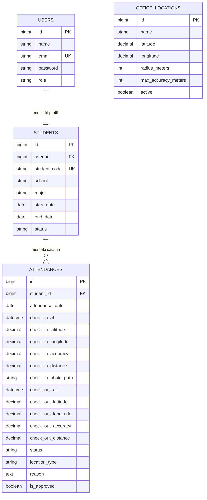
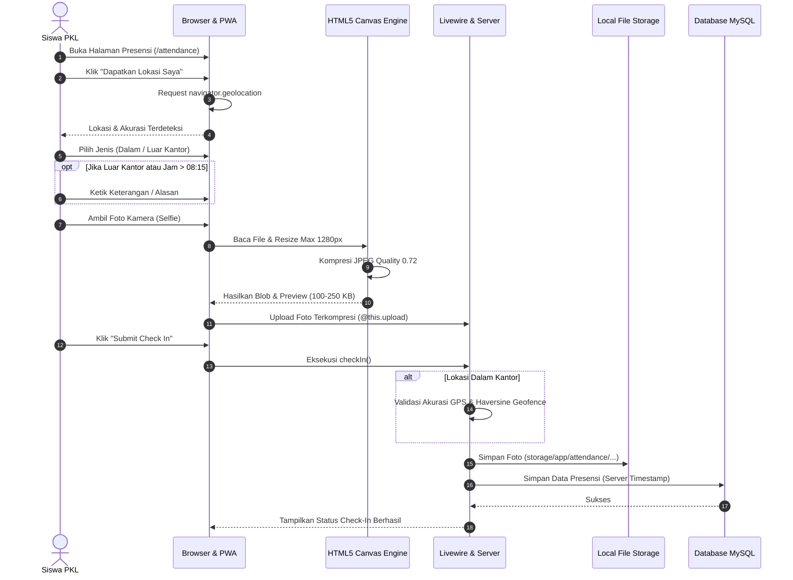

# Product Requirements Document (PRD) v2.0

# Sistem Presensi Peserta PKL Berbasis Web Geofencing & Progressive Web App (PWA)

**Perusahaan Target:** PT Fiber Networks Indonesia (Fibernet) Branch Palu  
**Kategori Proyek:** Internal Operational Web Application & PWA  
**Versi Dokumen:** 2.0 (Updated Release)  
**Tanggal Rilis:** Oktober 2026  
**Status Implementasi:** Fully Implemented & Operational  
**Framework & Teknologi:** Laravel 12, Livewire 3, Alpine.js, Tailwind CSS, Flux UI, HTML5 Geolocation, Canvas API, PWA Service Worker  

---

## Daftar Isi
1. [Ringkasan Eksekutif](#1-ringkasan-eksekutif)
2. [Latar Belakang & Analisis Masalah](#2-latar-belakang--analisis-masalah)
3. [Tujuan Produk & Sasaran Strategis](#3-tujuan-produk--sasaran-strategis)
4. [Target Pengguna & Persona](#4-target-pengguna--persona)
5. [Ruang Lingkup Produk (Scope v2.0 vs Non-Goals)](#5-ruang-lingkup-produk-scope-v20-vs-non-goals)
6. [Konsep & Mekanisme Inti Geofencing](#6-konsep--mekanisme-inti-geofencing)
7. [Mekanisme Presensi Ganda (Dalam Kantor vs Luar Kantor)](#7-mekanisme-presensi-ganda-dalam-kantor-vs-luar-kantor)
8. [Aturan Waktu, Toleransi Keterlambatan, & Batas Akhir Presensi](#8-aturan-waktu-toleransi-keterlambatan--batas-akhir-presensi)
9. [Fitur Kompresi Gambar di Sisi Klien (Client-Side Canvas Compression)](#9-fitur-kompresi-gambar-di-sisi-klien-client-side-canvas-compression)
10. [Manajemen Siklus Hidup Peserta PKL & Keamanan Sesi](#10-manajemen-siklus-hidup-peserta-pkl--keamanan-sesi)
11. [Sinkronisasi Absensi Otomatis (Automated Absentee Sync)](#11-sinkronisasi-absensi-otomatis-automated-absentee-sync)
12. [Perhitungan Durasi Kerja & Audit Trail Lokasi Interaktif](#12-perhitungan-durasi-kerja--audit-trail-lokasi-interaktif)
13. [Progressive Web App (PWA) & Dukungan Mobile](#13-progressive-web-app-pwa--dukungan-mobile)
14. [Desain Antarmuka & Pengalaman Pengguna (UI/UX)](#14-desain-antarmuka--pengalaman-pengguna-uiux)
15. [Modul Pelaporan & Ekspor Data (Excel/XLSX)](#15-modul-pelaporan--ekspor-data-excelxlsx)
16. [Manajemen Konfigurasi Geofence Dinamis](#16-manajemen-konfigurasi-geofence-dinamis)
17. [Arsitektur Teknis Sistem](#17-arsitektur-teknis-sistem)
18. [Spesifikasi Basis Data & Skema Model](#18-spesifikasi-basis-data--skema-model)
19. [Entity Relationship Diagram (ERD)](#19-entity-relationship-diagram-erd)
20. [Alur Kerja Sistem (System Workflows)](#20-alur-kerja-sistem-system-workflows)
21. [Spesifikasi Use Case (UC-01 s/d UC-10)](#21-spesifikasi-use-case-uc-01-sd-uc-10)
22. [Kebutuhan Fungsional (Functional Requirements)](#22-kebutuhan-fungsional-functional-requirements)
23. [Kebutuhan Non-Fungsional (Non-Functional Requirements)](#23-kebutuhan-non-fungsional-non-functional-requirements)
24. [Matriks Aturan Bisnis & Penanganan Kondisi Error](#24-matriks-aturan-bisnis--penanganan-kondisi-error)
25. [Requirements Traceability Matrix (RTM)](#25-requirements-traceability-matrix-rtm)
26. [Kriteria Keberterimaan (Acceptance Criteria)](#26-kriteria-keberterimaan-acceptance-criteria)
27. [Panduan Operasional & Pemeliharaan](#27-panduan-operasional--pemeliharaan)

---

## 1. Ringkasan Eksekutif

Sistem Presensi Peserta PKL Berbasis Web Geofencing PT Fiber Networks Indonesia (Fibernet) Branch Palu adalah platform operasional terpadu yang memodernisasi dan mengotomatisasi pencatatan kehadiran peserta Praktik Kerja Lapangan (PKL)/magang. Sebelumnya, proses kehadiran dilakukan manual menggunakan aplikasi kamera *timestamp* pihak ketiga dan bukti dikirimkan ke grup percakapan WhatsApp.

Sistem v2.0 ini telah berkembang melampaui prototipe awal menjadi aplikasi produksi berfitur lengkap yang mengintegrasikan:
1. **Verifikasi Lokasi Multi-Tipe:** Mendukung presensi "Di Dalam Kantor" (validasi koordinat Haversine dan radius Geofence) serta "Di Luar Kantor (Dinas/Kunjungan Lapangan)" dengan sistem persetujuan (*approval*).
2. **Kompresi Gambar Sisi Klien (Client-Side Compression):** Mengompres foto tangkapan kamera secara lokal di browser melalui HTML5 Canvas hingga ukuran 100–250 KB (efisiensi penyimpanan & bandwidth > 90%) sebelum dikirim ke server.
3. **Audit Trail Komprehensif:** Titik koordinat terhubung langsung (*hyperlink*) ke Google Maps, pencatatan akurasi GPS, serta kalkulasi otomatis total jam kerja harian.
4. **Manajemen Periode & Akses Siswa:** Validasi otomatis masa aktif PKL (*start_date* hingga *end_date*) dengan proteksi logout paksa (*middleware*) jika masa PKL habis atau dinonaktifkan admin.
5. **Sinkronisasi Absensi Harian Otomatis:** Deteksi dan pencatatan otomatis status Alpa bagi siswa yang tidak hadir setelah pukul 17:00 pada hari kerja.
6. **Progressive Web App (PWA):** Dapat diinstal langsung di layar beranda (*Home Screen*) ponsel pintar (Android/iOS) dengan dukungan *service worker* dan halaman *offline fallback*.
7. **Dashboard Modern Soft-UI:** Antarmuka responsif dengan jam digital *real-time* untuk siswa dan visualisasi garis waktu (*timeline connector*) presensi untuk administrator.

---

## 2. Latar Belakang & Analisis Masalah

### 2.1 Kondisi Awal (As-Is)
- Siswa PKL mengambil foto kehadiran menggunakan aplikasi *timestamp camera*.
- Foto diunggah ke grup percakapan WhatsApp kantor setiap pagi dan sore.
- Pembimbing PKL / HRD mengunduh dan mencocokkan data secara manual ke lembar rekapitulasi Excel.

### 2.2 Dampak Masalah
- **Penyimpanan Terbuang:** Ribuan foto resolusi tinggi menumpuk di memori ponsel staf dan grup WhatsApp.
- **Rentan Kecurangan:** Manipulasi titik lokasi dan waktu jam perangkat rawan terjadi pada aplikasi *timestamp* kamera pihak ketiga.
- **Kesulitan Rekapitulasi:** Proses audit memakan waktu kerja ekstra, terutama saat menjelang penutupan masa magang dan penerbitan sertifikat/nilai.
- **Ketidakpastian Tugas Luar:** Siswa yang ditugaskan ke lapangan/site pelanggan sulit diverifikasi status kehadirannya secara terstruktur.

### 2.3 Solusi Sistem (To-Be)
Aplikasi web terintegrasi berbasis Geofencing dan PWA yang mencatat waktu resmi server (*server-side authoritative timestamp*), mengonfirmasi batas radius geofence kantor, menyediakan opsi dinas luar kantor berdasar persetujuan, mengompres foto langsung di gawai siswa, dan menyajikan rekapitulasi otomatis yang dapat diekspor ke format XLSX kapan saja.

---

## 3. Tujuan Produk & Sasaran Strategis

### 3.1 Tujuan Utama
Mewujudkan tata kelola presensi peserta PKL PT Fiber Networks Indonesia Branch Palu yang akurat, transparan, hemat sumber daya (server storage & bandwidth), serta bebas dari rekapitulasi manual.

### 3.2 Tujuan Khusus
1. Menjamin keabsahan lokasi kehadiran melalui kalkulasi matematis Haversine di server dan pengecekan ambang batas akurasi GPS gawai.
2. Memfasilitasi fleksibilitas operasional bagi peserta yang ditugaskan dinas luar kantor dengan mekanisme *justification* dan *approval*.
3. Menerapkan penghematan penyimpanan server dan kuota internet peserta melalui kompresi grafis berbasis *HTML5 Canvas* sebelum proses unggah.
4. Mencegah manipulasi waktu kehadiran dengan menjadikan *server timestamp* sebagai sumber waktu mutlak (mengabaikan jam lokal gawai).
5. Mengotomatisasi siklus hidup akun siswa magang agar hak akses terputus secara tertib saat masa magang berakhir.
6. Menyediakan antarmuka dashboard eksekutif yang informatif, estetis, dan fungsional bagi pembimbing.

---

## 4. Target Pengguna & Persona

### 4.1 Peserta PKL (Siswa / Mahasiswa Magang)
- **Karakteristik:** Menggunakan perangkat seluler (smartphone Android/iOS), kuota internet terbatas, mobilitas tinggi antara kantor dan lapangan.
- **Kebutuhan:** Antarmuka absen yang cepat, tombol yang jelas, konfirmasi status seketika, dan kemampuan melihat rekap presensi pribadi.
- **Hak Akses:**
  - Registrasi mandiri akun PKL (NIM/NISN, asal instansi, jurusan, periode magang).
  - Akses Dashboard Siswa dengan jam digital *real-time*.
  - Melakukan *Check-In* (pilihan Dalam/Luar Kantor, unggah bukti foto kompresi, input alasan jika relevan).
  - Melakukan *Check-Out* harian.
  - Memantau 10 riwayat presensi terakhir dan status persetujuan.

### 4.2 Administrator / Pembimbing PKL / Branch Manager
- **Karakteristik:** Menggunakan laptop/desktop atau tablet di kantor, membutuhkan pengawasan cepat dan laporan siap cetak.
- **Kebutuhan:** Visibilitas real-time kehadiran harian, kemampuan validasi izin luar kantor/keterlambatan, audit foto dan lokasi, serta ekspor laporan.
- **Hak Akses:**
  - Akses Admin Dashboard dengan ringkasan metrik 4 kartu dan tabel visual *timeline*.
  - Manajemen Peserta PKL (perpanjangan tanggal *end_date*, aktivasi/penonaktifan akun).
  - Laporan & filter presensi berdasarkan rentang tanggal, status, dan siswa.
  - Verifikasi / approval presensi (Terima Hadir, Terima Terlambat, Tolak Alpa).
  - Pemeriksaan detail presensi (inspeksi foto terproteksi, koordinat Google Maps, durasi kerja).
  - Ekspor berkas laporan resmi berformat `.xlsx` (Excel).
  - Konfigurasi parameter Geofence kantor (koordinat, radius, batas akurasi GPS, status aktif).

---

## 5. Ruang Lingkup Produk (Scope v2.0 vs Non-Goals)

### 5.1 In-Scope (Fitur yang Diimplementasikan)
- **Autentikasi & Registrasi:** Laravel Fortify dengan registrasi khusus data siswa, manajemen sesi, dan pembatasan peran (*Role Middleware*).
- **Dual Location Mode:** Pilihan presensi *Inside Office* (validasi Geofence) dan *Outside Office* (bypass Geofence + wajib alasan + pending approval).
- **Geofence Server Engine:** Perhitungan Haversine formula, validasi akurasi GPS maksimal, penolakan otomatis presensi di luar radius.
- **Dynamic Geofence Settings:** Form admin untuk mengubah koordinat lintang/bujur, radius (meter), dan batas akurasi GPS kantor secara langsung.
- **Aturan Jam Kerja:** 
  - Batas tepat waktu: $\le$ 08:15 WITA.
  - Batas terlambat: > 08:15 WITA (wajib mengisi alasan + pending approval).
  - Batas tutup presensi: 17:00 WITA (setelah jam 17:00 tidak dapat check-in).
- **Client-Side Image Compression:** Kompresi otomatis berbasis browser canvas (max 1280px, JPEG 72%) sebelum upload Livewire, pratinjau foto langsung dengan informasi ukuran byte.
- **Perhitungan Waktu Kerja:** Selisih waktu otomatis antara *check-in* dan *check-out* (format: X Jam Y Menit).
- **Tautan Peta Interaktif:** Koordinat GPS di halaman admin terhubung langsung ke pin Google Maps.
- **Middleware Proteksi Siswa:** Pengecekan aktifitas akun dan masa berlaku magang (`CheckStudentActive`).
- **Sinkronisasi Alpa Otomatis:** Backfill otomatis status 'absent' untuk hari kerja yang terlewat.
- **Alur Persetujuan (Approval System):** Kemampuan admin menerima/menolak presensi luar kantor atau terlambat.
- **PWA (Progressive Web App):** Web Manifest, Service Worker caching, dan halaman offline fallback.
- **Ekspor Excel:** Format berkas XLSX dengan header korporat (*cyan*), informasi detail lengkap, dan fitur auto-width kolom.

### 5.2 Out-of-Scope (Non-Goals)
- Face Recognition / Face Matching AI (tetap menggunakan verifikasi visual manusia oleh admin).
- Integrasi bot WhatsApp API otomatis.
- Multi-cabang serentak dalam satu akun (sistem difokuskan untuk operasional Branch Palu).
- Modul penilaian kinerja akademik / logbook harian jurnal kegiatan magang.
- Cloud object storage pihak ketiga (AWS S3/GCS); penyimpanan tetap menggunakan *local protected storage* server.

---

## 6. Konsep & Mekanisme Inti Geofencing

### 6.1 Formula Matematika Haversine
Perhitungan jarak antara posisi peserta PKL ($lat_1, lon_1$) dan titik acuan kantor PT Fibernet Palu ($lat_2, lon_2$) dihitung secara absolut di sisi server menggunakan rumus Haversine:

$$\Delta lat = lat_2 - lat_1$$
$$\Delta lon = lon_2 - lon_1$$
$$a = \sin^2\left(\frac{\Delta lat}{2}\right) + \cos(lat_1) \cdot \cos(lat_2) \cdot \sin^2\left(\frac{\Delta lon}{2}\right)$$
$$c = 2 \cdot \arcsin\left(\sqrt{a}\right)$$
$$d = R \cdot c$$

Di mana $R$ adalah radius bumi ($6.371.000$ meter) dan $d$ adalah jarak dalam meter.

### 6.2 Validasi Dua Lapis (Two-Layer Validation)
Sistem menerapkan dua kriteria mutlak sebelum presensi dalam kantor disetujui:
1. **Validasi Kualitas Sinyal GPS (Accuracy Check):**
   $$\text{Akurasi Perangkat (meter)} \le \text{Batas Maksimal Akurasi Kantor (meter)}$$
   *Default: 50 meter.* Jika sinyal buruk (misal 120m), permintaan ditolak seketika karena posisi tidak dapat dipercaya.
2. **Validasi Radius Jarak (Radius Check):**
   $$d \le \text{Radius Geofence Kantor (meter)}$$
   *Default: 100 meter.* Jika $d > 100\text{ m}$, sistem menolak presensi dengan menampilkan jarak riil siswa dari kantor.

---

## 7. Mekanisme Presensi Ganda (Dalam Kantor vs Luar Kantor)

Sistem mengakomodasi penugasan operasional lapangan (seperti pemasangan kabel fiber optik, perbaikan gangguan, atau kunjungan instansi) melalui dua mode:

```
                      ┌────────────────────────┐
                      │  Pilihan Lokasi Siswa  │
                      └───────────┬────────────┘
                                  │
                  ┌───────────────┴───────────────┐
                  ▼                               ▼
       [ Di Dalam Kantor ]             [ Di Luar Kantor (Dinas) ]
                  │                               │
        Validasi Geofence & GPS        Bypass Radius Geofence
                  │                               │
        Apakah dalam radius?            Wajib Isi Alasan / Memo
        ├── Ya  ──► Status Sesuai Jam             │
        └── Tidak ─► Tolak Presensi     Status: PENDING APPROVAL
                                                  │
                                        Admin Meninjau di Laporan
                                        ├── Terima (Hadir / Terlambat)
                                        └── Tolak (Alpa)
```

| Parameter | Di Dalam Kantor (*Inside*) | Di Luar Kantor (*Outside*) |
|---|---|---|
| **Verifikasi Geofence** | Ya (Wajib $\le$ radius kantor) | Dibebaskan (*Bypassed*) |
| **Pencatatan Koordinat** | Ya (Latitude, Longitude, Accuracy) | Ya (Latitude, Longitude, Accuracy) |
| **Kewajiban Alasan** | Hanya jika terlambat (> 08:15) | Wajib selalu diisi ($\ge$ 3 karakter) |
| **Status Persetujuan Awal** | Langsung *Approved* (jika tepat waktu) | Selalu *Pending Approval* (`is_approved = false`) |
| **Hak Validasi** | Otomatis oleh sistem | Pembimbing / Admin melalui halaman laporan |

---

## 8. Aturan Waktu, Toleransi Keterlambatan, & Batas Akhir Presensi

Sistem menggunakan zona waktu resmi server (WITA / Asia/Makassar).

### 8.1 Klasifikasi Status Kehadiran
1. **HADIR (Present):**
   - Siswa melakukan *check-in* pada pukul $\le$ **08:15:00 WITA**.
   - Presensi disetujui otomatis jika berada di dalam kantor.
2. **TERLAMBAT (Late):**
   - Siswa melakukan *check-in* setelah pukul **08:15:00 WITA**.
   - Input alasan/keterangan menjadi wajib diisi.
   - Presensi ditandai sebagai *Pending Approval* agar admin dapat mengevaluasi alasan keterlambatan.
3. **ALPA / ABSEN (Absent):**
   - Siswa tidak melakukan *check-in* hingga hari berakhir.
   - Dibuat secara otomatis melalui mekanisme sinkronisasi harian setelah pukul 17:00 WITA.

### 8.2 Batas Penutupan Check-In (Cutoff 17:00)
- Setelah pukul **17:00:00 WITA**, sistem mengunci akses *check-in*.
- Siswa yang mencoba melakukan *check-in* setelah pukul 17:00 akan menerima pesan penolakan dan dicatat sebagai Alpa.

---

## 9. Fitur Kompresi Gambar di Sisi Klien (Client-Side Canvas Compression)

Untuk mengatasi permasalahan penumpukan memori server dan pemborosan kuota siswa, kompresi grafis dilakukan secara menyeluruh di gawai siswa sebelum berkas ditransmisikan.

```
 Kamera / Galeri Ponsel (Foto 3 MB – 8 MB)
                     │
                     ▼
           HTML5 FileReader API
                     │
                     ▼
             Image Object (RAM)
                     │
                     ▼
    Resize Proporsional (Max 1280px)
                     │
                     ▼
     HTML5 Canvas & toBlob('image/jpeg', 0.72)
                     │
                     ▼
   File Hasil Kompresi (100 KB – 250 KB)
                     │
     ┌───────────────┴───────────────┐
     ▼                               ▼
 Tampilkan Pratinjau          Unggah via Livewire
 & Ukuran Riil Siswa           ke Storage Server
```

### 9.1 Parameter Kompresi
- **Maksimum Dimensi:** 1280 piksel (sisi terpanjang disesuaikan proporsional sesuai rasio aspek foto asli).
- **Format Output:** `image/jpeg` (standar universal kompatibel lintas browser).
- **Tingkat Kualitas (*Quality Factor*):** `0.72` (72%), memberikan keseimbangan optimal antara ketajaman wajah dan efisiensi ukuran file.
- **Hasil Reduksi:** Berkas asli berukuran 3–8 MB berkurang menjadi 100–250 KB (penghematan $\approx 92\%-96\%$).

### 9.2 Pengalaman Pengguna (UX) Terintegrasi
- Indikator pemrosesan: *"Sedang memproses & mengompres foto..."* saat proses canvas berjalan.
- Pratinjau langsung: Foto yang telah dikompres ditampilkan di layar lengkap dengan catatan ukuran file (misal: *"Ukuran foto: 142 KB (dari 4280 KB)"*).
- Tombol *Submit Check In* dilindungi agar hanya aktif setelah proses kompresi dan unggahan selesai (`!uploading`).

---

## 10. Manajemen Siklus Hidup Peserta PKL & Keamanan Sesi

### 10.1 Manajemen Periode Magang
Setiap siswa terikat pada rentang masa kerja:
- `start_date`: Tanggal dimulainya program PKL.
- `end_date`: Tanggal penarikan / selesainya program PKL.
- `status`: Status keaktifan akun (`active` atau `inactive`).

### 10.2 Middleware `CheckStudentActive`
Sistem menerapkan pengamanan sesi pada tingkat rute web (`/dashboard`, `/attendance`):
1. **Pengecekan Status Akun:** Jika status siswa diubah menjadi `inactive` oleh admin, pengguna akan otomatis dikeluarkan dari sesi (*forced logout*) dan diarahkan ke login dengan pesan: *"Akun PKL Anda telah dinonaktifkan."*
2. **Pengecekan Kedaluwarsa Tanggal:** Jika tanggal berjalan telah melewati batas akhir (`now() > end_date 23:59:59`), sesi langsung dibatalkan dengan pesan: *"Masa PKL Anda telah berakhir pada [Tanggal]. Hubungi Admin untuk perpanjangan."*
3. **Pembaruan Mandiri oleh Admin:** Admin dapat memperpanjang tanggal `end_date` atau mengaktifkan kembali akun siswa kapan saja melalui modal edit di menu *Peserta PKL*.

---

## 11. Sinkronisasi Absensi Otomatis (Automated Absentee Sync)

Sistem mencegah kekosongan data historis presensi melalui metode `syncAbsentees()` yang berjalan saat halaman laporan dibuka atau diekspor.

### 11.1 Aturan Sinkronisasi
1. Menghitung hari kerja kalender (Senin–Jumat) antara tanggal awal filter dan tanggal akhir filter (maksimal hingga hari ini).
2. Mengecualikan hari libur akhir pekan (*weekend bypass*).
3. Untuk hari yang sedang berjalan (*today*), status Alpa baru diterapkan jika waktu telah melewati pukul **17:00 WITA**.
4. Hanya memproses siswa dengan status `active` dan tanggal yang berada di dalam rentang `start_date` sampai `end_date` siswa tersebut.
5. Menggunakan `firstOrCreate()` untuk menjamin ketiadaan duplikasi record presensi pada hari yang sama.

---

## 12. Perhitungan Durasi Kerja & Audit Trail Lokasi Interaktif

### 12.1 Kalkulasi Waktu Kerja
- Di halaman detail laporan admin (`/reports/{attendance}`), sistem menghitung selisih waktu antara `check_in_at` dan `check_out_at` menggunakan Carbon API.
- Ditampilkan dalam format: `X Jam Y Menit` (misal: *8 Jam 45 Menit*).
- Pada tabel dashboard admin dan laporan, durasi direpresentasikan secara visual berupa garis hubung (*timeline connector*) di antara jam masuk dan jam pulang.

### 12.2 Tautan Peta Koordinat Langsung
- Koordinat lintang dan bujur (*Latitude, Longitude*) untuk check-in dan check-out ditampilkan sebagai tautan aktif berwarna biru.
- Klik pada koordinat akan membuka Google Maps di tab baru dengan pin penanda lokasi riil:
  `https://maps.google.com/?q={latitude},{longitude}`
- Memudahkan pembimbing melakukan investigasi lokasi presensi tanpa perlu menyalin koordinat manual.

---

## 13. Progressive Web App (PWA) & Dukungan Mobile

Aplikasi didesain mengutamakan kenyamanan perangkat seluler (*mobile-first*).

### 13.1 Karakteristik PWA
- **Web App Manifest (`/manifest.json`):**
  - Nama: *Absensi PKL Fibernet*
  - Display: `standalone` (tampilan penuh tanpa bilah alamat browser).
  - Tema Warna: `#0891b2` (*Cyan 600* identitas Fibernet).
  - Ikon aplikasi: Ukuran 192x192 dan 512x512 *maskable*.
- **Service Worker (`/sw.js`):**
  - Meng-cache berkas statis utama saat instalasi.
  - Intersepsi navigasi: Jika perangkat siswa tiba-tiba kehilangan koneksi internet saat membuka aplikasi, browser secara otomatis menyajikan halaman `/offline` yang ramah pengguna.
- **Add to Home Screen:** Siswa dapat memasang aplikasi langsung ke layar utama Android (Chrome) atau iOS (Safari) tanpa melalui Play Store / App Store.

---

## 14. Desain Antarmuka & Pengalaman Pengguna (UI/UX)

Sistem mengadopsi palet warna modern korporat PT Fiber Networks Indonesia (dominasi nuansa *Cyan* yang bersih, latar abu-abu netral, dan kartu *soft UI*).

### 14.1 Dashboard Siswa
- **Kartu Jam Digital Dinamis:** Menggunakan Alpine.js untuk menampilkan jam, menit, dan detik yang berdetak *real-time* sesuai zona lokal pengguna.
- **Badge Status Harian Besar:** Kotak penanda besar yang menampilkan kondisi hari ini (*HADIR*, *TERLAMBAT*, *ABSEN*, atau *BELUM PRESENSI*).
- **Ringkasan Profil PKL:** Kartu informasi identitas, instansi, jurusan, dan sisa masa magang.
- **10 Riwayat Presensi Terakhir:** Tabel cepat status presensi 10 hari terakhir.

### 14.2 Dashboard Admin
- **Header Bersih & Minimalis:** Navigasi cepat ke laporan dan status operasional.
- **4 Kartu Metrik Utama:**
  1. *Total Peserta PKL* (Latar *soft cyan*).
  2. *Hadir Tepat Waktu* (Latar putih dengan aksen hijau emerald).
  3. *Terlambat* (Latar putih dengan aksen kuning amber).
  4. *Tidak Hadir / Belum Absen* (Latar *soft rose/red*).
- **Garis Waktu (Visual Timeline Connector):** Kolom check-in dan check-out disatukan dengan visualisasi titik awal, garis durasi, dan titik akhir:
  `[07:58 AM] ●────── 8h 55m ──────○ [04:53 PM]`

---

## 15. Modul Pelaporan & Ekspor Data (Excel/XLSX)

### 15.1 Filter Data Komprehensif
Admin dapat memfilter data presensi di `/reports` berdasarkan:
- Tanggal Mulai (*Start Date*) dan Tanggal Selesai (*End Date*).
- Status Kehadiran (*Present*, *Late*, *Absent*).
- Nama Siswa tertentu.

### 15.2 Ekspor Spreadsheet Resmi
- Format berkas: Microsoft Excel OpenXML (`.xlsx`).
- Penamaan berkas otomatis: `rekap-presensi-{start_date}-to-{end_date}.xlsx`.
- **Tata Letak Header:** Latar belakang warna *Cyan 600* (`#0891B2`) dengan teks putih tebal (*bold*).
- **Kolom Rekap:**
  1. NIM/NISN
  2. Nama Peserta
  3. Sekolah/Kampus
  4. Tanggal Presensi
  5. Waktu Check In
  6. Waktu Check Out
  7. Jenis Presensi (Dalam Kantor / Luar Kantor)
  8. Status Kehadiran (HADIR / TERLAMBAT / ABSEN)
  9. Jarak ke Kantor (meter)
  10. Akurasi GPS (meter)
- Kolom otomatis disesuaikan lebarnya (*auto-size columns*).

---

## 16. Manajemen Konfigurasi Geofence Dinamis

Tidak ada lagi koordinat yang di-*hardcode* di dalam kode program. Admin dapat mengelola geofence secara dinamis di halaman `/settings/geofence`.

### 16.1 Atribut Konfigurasi Kantor
- **Nama Kantor:** Identitas lokasi (contoh: *PT Fiber Networks Indonesia Branch Palu*).
- **Latitude & Longitude:** Titik koordinat desimal (antara -90 s/d 90 dan -180 s/d 180).
- **Radius Presensi (Meter):** Jarak maksimal yang diizinkan (minimal 10 meter, default 100 meter).
- **Batas Akurasi GPS (Meter):** Toleransi kesalahan sinyal GPS perangkat (minimal 5 meter, default 50 meter).
- **Status Aktif:** Sakelar pengaktifan titik geofence kantor.

---

## 17. Arsitektur Teknis Sistem

Aplikasi dibangun menggunakan pola arsitektur **MVC + Service Layer** di atas ekosistem Laravel modern:

```
├── app/
│   ├── Actions/Fortify/          # Alur autentikasi & pembuatan user/student
│   ├── Http/
│   │   ├── Controllers/
│   │   │   ├── DashboardController.php   # Agregasi data dashboard admin & siswa
│   │   │   └── ReportController.php      # Filter, sinkronisasi, persetujuan & ekspor
│   │   └── Middleware/
│   │       ├── CheckStudentActive.php    # Validasi masa aktif siswa magang
│   │       └── RoleMiddleware.php        # Otorisasi berbasis peran admin/student
│   ├── Livewire/
│   │   └── StudentsIndex.php             # Komponen manajemen data peserta PKL
│   ├── Models/
│   │   ├── Attendance.php                # Entitas presensi & relasi
│   │   ├── OfficeLocation.php            # Entitas geofence kantor aktif
│   │   ├── Student.php                   # Entitas profil magang siswa
│   │   └── User.php                      # Entitas akun & kredensial
│   └── Services/
│       ├── AttendanceService.php         # Logika bisnis check-in, check-out & status
│       ├── AttendanceReportService.php   # Formatting ekspor Excel Maatwebsite
│       └── GeofenceService.php           # Kalkulasi Haversine & validasi GPS
├── resources/views/
│   ├── dashboard/                        # Tampilan dashboard admin & siswa
│   ├── livewire/
│   │   └── student-attendance.blade.php  # Komponen presensi, kamera & kompresi JS
│   ├── pages/settings/
│   │   └── geofence.blade.php            # Manajemen geofence admin
│   └── reports/                          # Tampilan tabel laporan & detail audit
└── public/
    ├── manifest.json                     # Konfigurasi PWA Web App
    └── sw.js                             # Service Worker & offline cache
```

---

## 18. Spesifikasi Basis Data & Skema Model

### 18.1 Tabel `users`
| Kolom | Tipe Data | Keterangan |
|---|---|---|
| `id` | BIGINT UNSIGNED (PK) | Auto increment |
| `name` | VARCHAR(255) | Nama lengkap pengguna |
| `email` | VARCHAR(255) (UNIQUE) | Alamat email login |
| `password` | VARCHAR(255) | Hash password (Bcrypt) |
| `role` | VARCHAR(255) | Peran: `'admin'` atau `'student'` |
| `created_at` / `updated_at` | TIMESTAMP | Waktu pembuatan / perubahan |

### 18.2 Tabel `students`
| Kolom | Tipe Data | Keterangan |
|---|---|---|
| `id` | BIGINT UNSIGNED (PK) | Auto increment |
| `user_id` | BIGINT UNSIGNED (FK) | Relasi ke `users.id` (Cascade delete) |
| `student_code` | VARCHAR(255) (UNIQUE) | NIM atau NISN siswa |
| `school` | VARCHAR(255) | Asal sekolah atau universitas |
| `major` | VARCHAR(255) | Jurusan / Program studi |
| `start_date` | DATE | Tanggal mulai magang PKL |
| `end_date` | DATE | Tanggal penarikan / selesai PKL |
| `status` | VARCHAR(255) | Status akun: `'active'` atau `'inactive'` |
| `created_at` / `updated_at` | TIMESTAMP | Waktu pencatatan |

### 18.3 Tabel `office_locations`
| Kolom | Tipe Data | Keterangan |
|---|---|---|
| `id` | BIGINT UNSIGNED (PK) | Auto increment |
| `name` | VARCHAR(255) | Nama lokasi kantor |
| `latitude` | DECIMAL(10, 8) | Titik koordinat lintang |
| `longitude` | DECIMAL(11, 8) | Titik koordinat bujur |
| `radius_meters` | INT | Radius jangkauan presensi (meter) |
| `max_accuracy_meters` | INT | Batas toleransi sinyal GPS (meter) |
| `active` | BOOLEAN | Status aktifitas titik geofence |
| `created_at` / `updated_at` | TIMESTAMP | Waktu pencatatan |

### 18.4 Tabel `attendances`
| Kolom | Tipe Data | Keterangan |
|---|---|---|
| `id` | BIGINT UNSIGNED (PK) | Auto increment |
| `student_id` | BIGINT UNSIGNED (FK) | Relasi ke `students.id` (Cascade delete) |
| `attendance_date` | DATE | Tanggal presensi (Unique bersama `student_id`) |
| `check_in_at` | DATETIME (NULLABLE) | Waktu resmi server saat check-in |
| `check_in_latitude` | DECIMAL(10, 8) (NULLABLE) | Koordinat lintang saat check-in |
| `check_in_longitude` | DECIMAL(11, 8) (NULLABLE) | Koordinat bujur saat check-in |
| `check_in_accuracy` | DECIMAL(8, 2) (NULLABLE) | Akurasi GPS gawai saat check-in |
| `check_in_distance` | DECIMAL(8, 2) (NULLABLE) | Jarak ke kantor dalam meter (jika dalam kantor) |
| `check_in_photo_path`| VARCHAR(255) (NULLABLE) | Path penyimpanan file foto terkompresi |
| `check_out_at` | DATETIME (NULLABLE) | Waktu resmi server saat check-out |
| `check_out_latitude` | DECIMAL(10, 8) (NULLABLE) | Koordinat lintang saat check-out |
| `check_out_longitude`| DECIMAL(11, 8) (NULLABLE) | Koordinat bujur saat check-out |
| `check_out_accuracy` | DECIMAL(8, 2) (NULLABLE) | Akurasi GPS gawai saat check-out |
| `check_out_distance` | DECIMAL(8, 2) (NULLABLE) | Jarak ke kantor dalam meter saat check-out |
| `status` | VARCHAR(255) | Status kehadiran: `'present'`, `'late'`, `'absent'` |
| `location_type` | VARCHAR(255) | Tipe lokasi: `'inside'` atau `'outside'` |
| `reason` | TEXT (NULLABLE) | Alasan dinas luar kantor atau keterlambatan |
| `is_approved` | BOOLEAN (NULLABLE) | Status persetujuan: `true`, `false` (pending), `null` |
| `created_at` / `updated_at` | TIMESTAMP | Waktu pencatatan |

---

## 19. Entity Relationship Diagram (ERD)



---

## 20. Alur Kerja Sistem (System Workflows)

### 20.1 Alur Presensi Check-In Lengkap


---

## 21. Spesifikasi Use Case (UC-01 s/d UC-10)

### UC-01: Registrasi Akun Siswa PKL
- **Aktor:** Siswa PKL
- **Prekondisi:** Pengguna belum terdaftar di sistem.
- **Alur Utama:**
  1. Pengguna membuka form registrasi (`/register`).
  2. Pengguna mengisi nama, email, password, NIM/NISN, asal sekolah, jurusan, tanggal mulai, dan tanggal selesai magang.
  3. Sistem memvalidasi keunikan email dan NIM/NISN, serta memastikan `end_date >= start_date`.
  4. Sistem menyimpan record pada tabel `users` (role `student`) dan tabel `students` (status `active`).
  5. Pengguna otomatis dialihkan ke Dashboard Siswa.

### UC-02: Otentikasi & Verifikasi Masa Aktif
- **Aktor:** Siswa / Admin
- **Alur Utama:**
  1. Pengguna memasukkan email dan password di `/login`.
  2. Sistem memverifikasi kredensial.
  3. Jika pengguna adalah siswa: Middleware `CheckStudentActive` memeriksa apakah `status == 'active'` dan `now() <= end_date`.
  4. Jika lolos, pengguna masuk ke dashboard terkait. Jika tidak lolos, sesi ditolak seketika.

### UC-03: Pengambilan Lokasi Geolocation
- **Aktor:** Siswa PKL
- **Alur Utama:**
  1. Siswa menekan tombol "Dapatkan Lokasi Saya" di halaman presensi.
  2. Browser meminta izin sensor lokasi GPS gawai (`enableHighAccuracy: true`).
  3. Sensor mengembalikan latitude, longitude, dan accuracy dalam meter.
  4. Koordinat disinkronkan ke komponen Alpine dan Livewire.

### UC-04: Kompresi & Pengambilan Foto Check-In
- **Aktor:** Siswa PKL
- **Alur Utama:**
  1. Siswa membuka kamera melalui input berkas (`capture="user"`).
  2. Siswa mengambil foto bukti kehadiran.
  3. Script Alpine menerima event perubahan file, memuatnya ke elemen `Image`, dan menggambarnya ke `Canvas`.
  4. Dimensi diperkecil proporsional hingga maksimal 1280px dan diekspor ke JPEG kualitas 72%.
  5. Sistem menampilkan pratinjau foto dan informasi ukuran terkompresi.
  6. File terkompresi diunggah ke server Livewire secara asinkron.

### UC-05: Eksekusi Presensi Masuk (Check-In)
- **Aktor:** Siswa PKL
- **Alur Utama:**
  1. Siswa memilih tipe lokasi (Dalam Kantor / Luar Kantor).
  2. Jika Luar Kantor atau waktu server > 08:15 WITA, siswa melengkapi alasan.
  3. Siswa menekan "Submit Check In".
  4. Server memverifikasi waktu tidak melewati batas penutupan 17:00 WITA.
  5. Server mengevaluasi geofence (jika dalam kantor).
  6. Server menyimpan foto ke disk privat dan menulis catatan presensi dengan waktu server.

### UC-06: Eksekusi Presensi Pulang (Check-Out)
- **Aktor:** Siswa PKL
- **Alur Utama:**
  1. Siswa yang telah check-in membuka halaman presensi di sore hari.
  2. Siswa mendeteksi lokasi GPS.
  3. Siswa menekan tombol "Check Out Presensi".
  4. Server memvalidasi geofence kepulangan (jika check-in di dalam kantor).
  5. Server mencatat `check_out_at` dan koordinat pulang.

### UC-07: Pemantauan Dashboard Admin
- **Aktor:** Admin / Pembimbing
- **Alur Utama:**
  1. Admin membuka dashboard `/dashboard`.
  2. Sistem menyajikan kartu agregat: Total Siswa, Hadir Tepat Waktu, Terlambat, dan Belum Absen/Alpa.
  3. Sistem menyajikan tabel presensi hari ini lengkap dengan konektor durasi jam kerja (*timeline*).

### UC-08: Tinjauan & Persetujuan Presensi (Approval)
- **Aktor:** Admin
- **Alur Utama:**
  1. Admin membuka menu Laporan Presensi (`/reports`).
  2. Admin memilih entri presensi yang memiliki status *Pending Approval*.
  3. Admin membuka detail presensi (`/reports/{attendance}`), meninjau foto, koordinat Google Maps, dan alasan siswa.
  4. Admin menekan salah satu tombol keputusan: "Terima (Hadir)", "Terima (Terlambat)", atau "Tolak (Alpa)".
  5. Sistem memperbarui status presensi dan menandai `is_approved = true`.

### UC-09: Ekspor Rekapitulasi Presensi (Excel)
- **Aktor:** Admin
- **Alur Utama:**
  1. Admin menentukan filter tanggal mulai dan tanggal selesai di menu laporan.
  2. Admin menekan tombol "Export XLSX".
  3. Sistem mengeksekusi sinkronisasi otomatis absensi (`syncAbsentees`) untuk hari kerja yang terlewat.
  4. Sistem menghasilkan berkas `.xlsx` dengan gaya tabel korporat dan memulai unduhan otomatis pada browser admin.

### UC-10: Pengelolaan Peserta PKL & Perpanjangan Periode
- **Aktor:** Admin
- **Alur Utama:**
  1. Admin membuka menu *Peserta PKL* (`/students`).
  2. Admin mencari siswa yang masa magangnya akan diperpanjang atau dinonaktifkan.
  3. Admin menekan tombol "Edit".
  4. Modal Flux UI muncul; admin mengubah `end_date` baru atau status keaktifan.
  5. Perubahan tersimpan secara reaktif tanpa me-refresh seluruh halaman.

---

## 22. Kebutuhan Fungsional (Functional Requirements)

- **FR-01 (Autentikasi Multi-Peran):** Sistem harus mendukung login, logout, dan pendaftaran mandiri dengan pemisahan peran admin dan student.
- **FR-02 (Manajemen Profil Siswa):** Sistem harus mencatat nomor induk (NIM/NISN), asal instansi, jurusan, dan periode masa magang siswa.
- **FR-03 (Pendeteksian Geolocation):** Sistem harus meminta izin lokasi dan membaca koordinat lintang, bujur, dan nilai akurasi dari sensor perangkat.
- **FR-04 (Validasi Akurasi GPS):** Sistem harus menolak presensi jika nilai akurasi GPS melebihi batas toleransi kantor (default 50 meter).
- **FR-05 (Validasi Geofence Haversine):** Sistem harus menghitung jarak matematis pengguna ke kantor dan menolak presensi jika jarak melebihi radius kantor (default 100 meter).
- **FR-06 (Mode Presensi Ganda):** Sistem harus menyediakan pilihan presensi "Di Dalam Kantor" dan "Di Luar Kantor (Dinas)".
- **FR-07 (Bypass Geofence Dinas Luar):** Sistem harus membebaskan validasi radius kantor bagi presensi dinas luar kantor namun mewajibkan pengisian alasan minimal 3 karakter.
- **FR-08 (Kewajiban Alasan Terlambat):** Siswa yang melakukan presensi setelah pukul 08:15 WITA wajib menyertakan keterangan/alasan.
- **FR-09 (Sistem Status Approval):** Presensi luar kantor dan presensi terlambat harus otomatis masuk ke status *Pending Approval*.
- **FR-10 (Tindakan Persetujuan Admin):** Admin harus dapat menyetujui (sebagai Hadir/Terlambat) atau menolak (sebagai Alpa) catatan presensi yang berstatus *Pending Approval*.
- **FR-11 (Batas Penutupan Presensi):** Sistem harus menolak seluruh upaya *check-in* yang dilakukan setelah pukul 17:00 WITA.
- **FR-12 (Kompresi Foto Sisi Klien):** Sistem harus mengompres foto kamera pada canvas browser hingga resolusi maksimal 1280px dan format JPEG 72% sebelum proses upload.
- **FR-13 (Pratinjau & Info Ukuran Foto):** Sistem harus menampilkan pratinjau gambar dan keterangan ukuran berkas terkompresi sebelum tombol submit ditekan.
- **FR-14 (Penyimpanan Foto Terproteksi):** Berkas foto presensi harus disimpan pada direktori lokal privat server (`storage/app/attendance/...`) dan hanya dapat diakses melalui rute terotorisasi.
- **FR-15 (Pencatatan Check-Out):** Sistem harus memfasilitasi pencatatan waktu kepulangan beserta lokasi koordinatnya setelah check-in berhasil.
- **FR-16 (Kalkulasi Jam Kerja):** Sistem harus menghitung selisih waktu antara check-in dan check-out dalam format jam dan menit.
- **FR-17 (Tautan Peta Interaktif):** Koordinat lintang dan bujur di detail laporan harus berupa tautan yang langsung membuka Google Maps di tab baru.
- **FR-18 (Proteksi Masa Magang Siswa):** Middleware harus memblokir dan me-logout otomatis siswa yang status akunnya dinonaktifkan atau masa magangnya telah kedaluwarsa.
- **FR-19 (Sinkronisasi Otomatis Alpa):** Sistem harus otomatis membuat record Alpa bagi siswa aktif pada hari kerja yang tidak memiliki catatan presensi setelah pukul 17:00 WITA.
- **FR-20 (Manajemen Siswa oleh Admin):** Admin harus dapat memperpanjang masa magang (`end_date`) dan mengubah status aktif/nonaktif siswa via modal antarmuka.
- **FR-21 (Ekspor XLSX Terformat):** Sistem harus dapat mengekspor rekapitulasi presensi ke format Excel dengan header cyan korporat dan filter fleksibel.
- **FR-22 (Konfigurasi Geofence Dinamis):** Admin harus dapat mengubah koordinat kantor, radius, dan batas toleransi akurasi GPS melalui menu pengaturan.
- **FR-23 (Jam Digital Real-Time):** Dashboard siswa harus menyajikan jam digital dinamis berdetak setiap detik sesuai waktu lokal.
- **FR-24 (PWA & Offline Fallback):** Sistem harus dapat diinstal ke Home Screen ponsel pintar dan menyajikan halaman offline saat koneksi terputus.

---

## 23. Kebutuhan Non-Fungsional (Non-Functional Requirements)

### 23.1 Keamanan (Security)
- Seluruh password dienkripsi menggunakan algoritma *Bcrypt*.
- Proteksi CSRF (*Cross-Site Request Forgery*) aktif pada setiap transaksi data formulir.
- Foto bukti presensi tidak diletakkan di direktori publik (`public/storage`), melainkan dialirkan melalui rute terproteksi otorisasi admin (`/reports/{attendance}/photo`).
- Seluruh waktu kehadiran dicatat bersumber dari waktu server lokal (*authoritative server clock*), kebal terhadap manipulasi jam gawai siswa.

### 23.2 Performa & Efisiensi Penyimpanan (Performance)
- **Kompresi Gambar:** Pengurangan beban transfer berkas rata-rata dari 5 MB menjadi < 200 KB per presensi, menghemat hingga 95% kapasitas hard disk server dan bandwidth jaringan.
- **Waktu Muat (Load Time):** Waktu respon halaman rata-rata $\le$ 1,5 detik pada jaringan 4G seluler.
- **Asinkronitas Livewire:** Transaksi UI dilakukan secara reaktif tanpa melakukan reload penuh (*full page reload*).

### 23.3 Kompatibilitas & Ketersediaan (Compatibility & Availability)
- Berjalan optimal pada peramban seluler modern: Google Chrome (Android), Safari (iOS), Mozilla Firefox, dan Samsung Internet.
- Desain antarmuka responsif (*mobile-first*) yang menyesuaikan tampilan layar dari ponsel kecil 360px hingga monitor desktop 4K.
- PWA Service Worker memastikan aplikasi tetap menampilkan informasi antarmuka cadangan saat siswa berada di area blindspot internet.

---

## 24. Matriks Aturan Bisnis & Penanganan Kondisi Error

| Kode Kondisi | Skenario Masalah | Respon & Tindakan Sistem |
|---|---|---|
| **BR-ERR-01** | Izin lokasi GPS ditolak oleh pengguna di browser | Menampilkan alert: *"Akses lokasi ditolak. Harap izinkan akses lokasi di browser Anda."* Presensi diblokir. |
| **BR-ERR-02** | Sinyal GPS tidak aktif / tidak ditemukan | Menampilkan alert: *"Lokasi tidak tersedia (GPS tidak aktif)."* Presensi diblokir. |
| **BR-ERR-03** | Akurasi GPS gawai terlalu rendah (> max_accuracy) | Menampilkan pesan error: *"Akurasi lokasi terlalu rendah ([X]m). Maksimal yang diizinkan adalah [Y]m. Coba aktifkan GPS dan ulangi."* |
| **BR-ERR-04** | Lokasi siswa di luar radius kantor (Mode Dalam) | Menampilkan pesan error: *"Anda berada di luar area presensi. Jarak Anda [X]m dari kantor (Maks: [Y]m)."* Presensi ditolak. |
| **BR-ERR-05** | Siswa mencoba check-in setelah jam 17:00 WITA | Menolak presensi: *"Batas waktu presensi hari ini telah berakhir (Pukul 17:00). Anda tercatat sebagai Alpa/Tidak Hadir."* |
| **BR-ERR-06** | Siswa check-in ulang pada tanggal yang sama | Menolak presensi: *"Anda sudah melakukan check-in hari ini."* |
| **BR-ERR-07** | Siswa check-out tanpa melakukan check-in terlebih dahulu | Menolak presensi: *"Anda belum melakukan check-in hari ini."* |
| **BR-ERR-08** | Siswa memilih Luar Kantor tapi mengosongkan alasan | Validasi form memblokir submit: *"Keterangan/Alasan wajib diisi (karena Anda memilih Luar Kantor atau terlambat)."* |
| **BR-ERR-09** | Siswa nonaktif / masa magang habis mencoba login | Middleware memutus sesi: *"Masa PKL Anda telah berakhir pada [Tanggal]. Hubungi Admin untuk perpanjangan."* |

---

## 25. Requirements Traceability Matrix (RTM)

| ID Req | Deskripsi Kebutuhan | File Implementasi Utama | Pengujian Terkait | Status |
|---|---|---|---|---|
| **FR-01** | Autentikasi & Registrasi Siswa | `app/Actions/Fortify/CreateNewUser.php` | Test Auth Fortify | ✅ Selesai |
| **FR-03** | Geolocation Browser | `resources/views/livewire/student-attendance.blade.php` | Geolocation API Test | ✅ Selesai |
| **FR-04** | Validasi Akurasi GPS | `app/Services/GeofenceService.php` | GeofenceServiceTest | ✅ Selesai |
| **FR-05** | Validasi Geofence Haversine | `app/Services/GeofenceService.php` | Haversine Formula Test | ✅ Selesai |
| **FR-06** | Mode Dalam & Luar Kantor | `app/Services/AttendanceService.php` | Dual Mode Feature Test | ✅ Selesai |
| **FR-08** | Toleransi Keterlambatan 08:15 | `app/Services/AttendanceService.php` | Time Boundary Test | ✅ Selesai |
| **FR-10** | Alur Persetujuan Admin | `app/Http/Controllers/ReportController.php` | Approval Flow Test | ✅ Selesai |
| **FR-11** | Cutoff Presensi 17:00 | `app/Services/AttendanceService.php` | Cutoff Validation Test | ✅ Selesai |
| **FR-12** | Kompresi Gambar Browser | `resources/views/livewire/student-attendance.blade.php` | Canvas Compression Test | ✅ Selesai |
| **FR-14** | Penyimpanan Foto Terproteksi | `app/Http/Controllers/ReportController.php` | Private Storage Test | ✅ Selesai |
| **FR-16** | Perhitungan Durasi Kerja | `resources/views/reports/show.blade.php` | Duration Diff Test | ✅ Selesai |
| **FR-17** | Tautan Pin Google Maps | `resources/views/reports/show.blade.php` | Link Rendering Test | ✅ Selesai |
| **FR-18** | Proteksi Periode Magang | `app/Http/Middleware/CheckStudentActive.php` | StudentActiveMiddlewareTest | ✅ Selesai |
| **FR-19** | Sinkronisasi Otomatis Alpa | `app/Http/Controllers/ReportController.php` | SyncAbsentees Test | ✅ Selesai |
| **FR-20** | Modal Perpanjang Magang | `app/Livewire/StudentsIndex.php` | Livewire Modal Test | ✅ Selesai |
| **FR-21** | Ekspor Laporan Excel | `app/Services/AttendanceReportService.php` | Excel Export Test | ✅ Selesai |
| **FR-22** | Pengaturan Geofence Dinamis | `resources/views/pages/settings/geofence.blade.php` | Geofence Setting Test | ✅ Selesai |
| **FR-23** | Jam Digital Real-Time | `resources/views/dashboard/student.blade.php` | Alpine Clock Test | ✅ Selesai |
| **FR-24** | Progressive Web App (PWA) | `public/manifest.json`, `public/sw.js` | Lighthouse PWA Audit | ✅ Selesai |

---

## 26. Kriteria Keberterimaan (Acceptance Criteria)

### 26.1 Presensi Siswa (Check-In & Check-Out)
- [x] Siswa hanya dapat absen masuk satu kali per hari kalender.
- [x] Koordinat lokasi wajib terdeteksi dengan akurasi $\le$ toleransi kantor (default 50m).
- [x] Jarak siswa di dalam kantor wajib $\le$ radius kantor (default 100m).
- [x] Siswa yang memilih "Luar Kantor" wajib mengisi form alasan minimal 3 karakter.
- [x] Foto berhasil dikompresi di browser menjadi ukuran < 300 KB sebelum diunggah.
- [x] Muncul pratinjau foto dan informasi ukuran hasil kompresi di layar gawai siswa.
- [x] Check-in di atas jam 08:15 WITA otomatis berstatus TERLAMBAT dan membutuhkan persetujuan admin.
- [x] Check-in setelah jam 17:00 WITA diblokir oleh sistem.

### 26.2 Pemantauan & Persetujuan Admin
- [x] Dashboard menampilkan 4 ringkasan metrik (Total Siswa, Hadir, Terlambat, Alpa/Belum).
- [x] Garis waktu presensi menampilkan jam masuk, garis durasi kerja, dan jam pulang.
- [x] Detail presensi menampilkan koordinat GPS yang dapat diklik membuka Google Maps.
- [x] Foto presensi hanya dapat dibuka oleh admin berwenang.
- [x] Admin dapat mengubah status presensi berstatus pending menjadi Hadir, Terlambat, atau Alpa.

### 26.3 Administrasi & Ekspor
- [x] Admin dapat memperpanjang masa berlaku magang peserta PKL dari menu Peserta PKL.
- [x] Siswa yang masa magangnya habis atau dinonaktifkan ter-logout secara otomatis.
- [x] Rekapitulasi dapat diekspor ke berkas Excel (`.xlsx`) dengan format tabel rapi.
- [x] Hari kerja yang terlewat otomatis diisi sebagai Alpa oleh sistem.
- [x] Admin dapat mengedit koordinat geofence kantor tanpa menyentuh source code.

---

## 27. Panduan Operasional & Pemeliharaan

### 27.1 Prasyarat Lingkungan Server
- **PHP:** Versi $\ge$ 8.2 dengan ekstensi `gd`, `fileinfo`, `pdo_mysql`, `mbstring`, `zip`, dan `exif`.
- **Database:** MySQL 8.0+ atau MariaDB 10.4+.
- **Web Server:** Nginx atau Apache (Laragon / cPanel) dengan dukungan URL Rewriting dan header HTTPS (wajib untuk akses Geolocation API browser).

### 27.2 Perawatan Rutin
1. **Pembersihan Cache Berkala:** Jalankan `php artisan optimize:clear` setelah pembaruan konfigurasi lingkungan.
2. **Pencadangan Basis Data & Berkas:** Lakukan backup harian pada database MySQL dan folder `storage/app/attendance/`.
3. **Pemberian Izin Browser:** Pastikan siswa memberikan izin permanen (*Always Allow*) untuk akses Kamera dan Lokasi pada peramban smartphone masing-masing.

---
*Dokumen ini merupakan spesifikasi resmi yang merepresentasikan seluruh arsitektur dan kapabilitas riil dari Sistem Presensi Peserta PKL PT Fiber Networks Indonesia Branch Palu per rilis Oktober 2026.*
