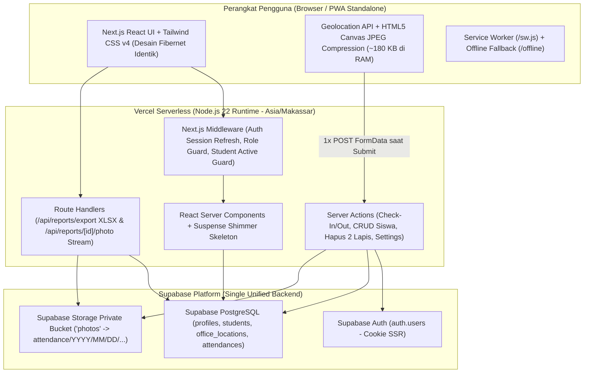

# Rancangan Refactor: Absensi PKL Fibernet ke Next.js + Supabase + Vercel

**Dokumen Arsitektur Teknis (100% Feature & Design Parity dengan Versi Laravel 13)**  
**Target Deployment:** Vercel (Frontend + Serverless Backend) & Supabase (PostgreSQL + Auth + Storage)  
**Zona Waktu Operasional:** `Asia/Makassar` (WITA / UTC+8 — PT Fiber Networks Indonesia Branch Palu)

---

## 1. Ringkasan Eksekutif & Tujuan

Dokumen ini merancang migrasi penuh aplikasi **Sistem Presensi PKL Geofencing PT Fiber Networks Indonesia Branch Palu** dari stack **Laravel 13 + Livewire 4 + Flux UI + MySQL (Railway)** ke ekosistem **Node.js + Next.js (App Router) + Supabase + Vercel** dengan dua syarat mutlak:

1. **100% Kesamaan Fitur & Aturan Bisnis (*Feature Parity*):** Seluruh alur autentikasi, masa aktif PKL, geofencing Haversine, kompresi foto kamera depan, deteksi keterlambatan (`> 08:15`), penutupan presensi (`17:00`), *auto-sync* status Alpa hari kerja, persetujuan presensi luar kantor/terlambat, filter sekolah & *export* `.xlsx` berwarna, hapus permanen peserta 2 tahap beserta foto bucket, hingga panel pemantau & pembersih kuota penyimpanan Supabase bekerja identik.
2. **100% Kesamaan Desain Visual & UX (*Pixel-for-Pixel Design Parity*):** Palet warna Fibernet, font *Instrument Sans*, *dark sidebar* (`#1e293b`), kartu statistik lembut (`cyan-50`, `rose-50`), *hybrid loading indicator* (top progress bar + *pill badge* `"Memuat..."` + *fullscreen blur overlay* saat login/register/logout + *shimmer skeleton* dashboard), serta pengalaman PWA *standalone* dipertahankan sama persis.

> [!TIP]
> **Keuntungan Arsitektur Baru di Next.js + Supabase:** Masalah duplikasi file `livewire-tmp` hilang secara permanen dari akar arsitektur. Di React/Next.js, kompresi foto kamera dilakukan di memori browser (`Blob`) tanpa perlu upload sementara ke server—file hanya diunggah **1 kali** saat tombol **Submit Check In** ditekan.

---

## 2. Arsitektur Sistem & Pemetaan Stack



### Tabel Pemetaan Teknologi (Laravel → Next.js Minimalis Tanpa Bloat)

| Lapisan | Versi Laravel Saat Ini | Versi Next.js + Supabase (Target) | Alasan Pemilihan (Efisien & Native) |
| :--- | :--- | :--- | :--- |
| **Runtime & Framework** | PHP 8.4 + Laravel 13 | **Node.js 22 LTS + Next.js 15/16 (App Router, TypeScript)** | Native di Vercel, dukungan penuh RSC, *Server Actions*, dan *Streaming Suspense*. |
| **Reaktivitas UI** | Livewire 4 + Alpine.js | **React 19 (`useState`, `useActionState`, `useTransition`)** | Standar bawaan Next.js tanpa perlu library state tambahan (tanpa Redux/Zustand). |
| **Komponen UI & Ikon** | Livewire Flux 2.13 + Heroicons | **Tailwind CSS v4 + `@heroicons/react` + Primitif UI Ringan (`<dialog>`, `sonner`)** | Mempertahankan tampilan visual, SVG ikon, modal, dan *toast* identik dengan Flux UI tanpa beban bundle besar. |
| **Autentikasi** | Laravel Fortify + Tabel `sessions` | **Supabase Auth (`@supabase/ssr`)** | Cookie HTTP-only aman, *Remember Me*, *Forgot/Reset Password* bawaan tanpa kelola tabel sesi/token manual. |
| **Database & Query** | MySQL + Eloquent ORM | **Supabase PostgreSQL + `@supabase/supabase-js` (Typed) + SQL RPC** | *Zero cold-start binary* di Vercel Serverless (jauh lebih ringan dibanding Prisma), tipe TypeScript otomatis dari skema DB. |
| **File Storage** | Flysystem S3 (`photos`) | **Supabase Storage SDK (`photos` Private Bucket)** | Satu ekosistem langsung dengan database; mendukung query metadata ukuran file langsung via SQL `storage.objects`. |
| **Export Excel** | Maatwebsite Excel (`PhpSpreadsheet`) | **`exceljs` (In-Memory Buffer di Route Handler)** | Menghasilkan `.xlsx` murni lengkap dengan *auto-width* kolom dan header warna Cyan `#0891B2` tanpa tulis ke disk. |

---

## 3. Struktur Folder Proyek Next.js

```text
absensi-fibernet-next/
├── public/
│   ├── apple-touch-icon.png
│   ├── favicon.ico
│   ├── favicon.svg
│   ├── fibernet.png
│   ├── logo-fibernet.png
│   ├── manifest.json                 # Identik 1:1 dengan versi Laravel
│   └── sw.js                         # Service Worker PWA & cache /offline
├── supabase/
│   ├── migrations/
│   │   └── 0001_initial_fibernet_schema.sql
│   └── seed.sql                      # Seed Admin & Lokasi Kantor Branch Palu
├── src/
│   ├── app/
│   │   ├── globals.css               # Salinan persis tema & utility resources/css/app.css
│   │   ├── layout.tsx                # Root HTML, Instrument Sans, PWA meta, GlobalLoader, Toaster
│   │   ├── page.tsx                  # Redirect '/' -> '/dashboard'
│   │   ├── offline/
│   │   │   └── page.tsx              # Halaman Offline identik
│   │   ├── (auth)/
│   │   │   ├── layout.tsx            # Layout .fibernet-auth-bg + kartu blur putih + logo
│   │   │   ├── login/page.tsx
│   │   │   ├── register/page.tsx
│   │   │   ├── forgot-password/page.tsx
│   │   │   └── reset-password/page.tsx
│   │   ├── (protected)/
│   │   │   ├── layout.tsx            # Sidebar gelap .fibernet-sidebar + Header Mobile
│   │   │   ├── dashboard/
│   │   │   │   ├── loading.tsx       # Shimmer Skeleton Dashboard (pengganti #[Defer])
│   │   │   │   └── page.tsx          # Render AdminDashboard atau StudentDashboard
│   │   │   ├── attendance/
│   │   │   │   └── page.tsx          # Check-In/Out kamera + GPS + Riwayat Presensi Saya
│   │   │   ├── students/             # Khusus Admin
│   │   │   │   └── page.tsx          # Tabel Peserta + Modal Edit + Modal Hapus Permanen 2 Tahap
│   │   │   ├── reports/              # Khusus Admin
│   │   │   │   ├── page.tsx          # Filter Tanggal/Sekolah/Status + Sync Alpa + Tabel Timeline
│   │   │   │   └── [id]/page.tsx     # Detail Presensi + Maps + Foto + Tombol Persetujuan
│   │   │   └── settings/
│   │   │       ├── layout.tsx        # Sub-navigasi Settings (Profil, Keamanan, Lokasi, Penyimpanan)
│   │   │       ├── page.tsx          # Redirect '/settings' -> '/settings/profile'
│   │   │       ├── profile/page.tsx  # Update profil + Hapus akun mandiri
│   │   │       ├── security/page.tsx # Ubah kata sandi
│   │   │       ├── geofence/page.tsx # Khusus Admin: Pengaturan koordinat & radius kantor
│   │   │       └── storage/page.tsx  # Khusus Admin: Info kuota Supabase & Bersihkan Sampah
│   │   └── api/
│   │       ├── auth/callback/route.ts         # Pertukaran kode PKCE reset password Supabase
│   │       └── reports/
│   │           ├── export/route.ts            # Stream unduhan file .xlsx
│   │           └── [id]/photo/route.ts        # Proxy foto presensi dari private bucket (Admin only)
│   ├── actions/
│   │   ├── auth.ts                   # loginAction, registerAction, logoutAction, passwordActions
│   │   ├── attendance.ts             # checkInAction, checkOutAction, approveAttendanceAction
│   │   ├── students.ts               # updateStudentAction, deleteStudentPermanentlyAction
│   │   └── settings.ts               # updateProfileAction, updateGeofenceAction, cleanupStorageAction
│   ├── components/
│   │   ├── layout/                   # AppSidebar, MobileHeader, DesktopUserMenu, GlobalLoader
│   │   ├── ui/                       # Button, Input (viewable password), Modal, Switch, Skeleton, Badge
│   │   ├── dashboard/                # AdminDashboardContent, StudentDashboardContent, LiveClock
│   │   ├── attendance/               # AttendanceFormClient (GPS + Canvas Compress), HistoryTable
│   │   ├── students/                 # StudentsTableClient, EditStudentModal, DeleteStudentTwoStepModal
│   │   ├── reports/                  # ReportsFilterBar, TimelineCell, ApprovalButtons
│   │   └── settings/                 # StorageOverviewClient, DeleteAccountModal
│   ├── lib/
│   │   ├── supabase/
│   │   │   ├── client.ts             # Browser client
│   │   │   ├── server.ts             # SSR Cookie client (anon key + RLS)
│   │   │   └── admin.ts              # Service Role client (khusus operasi Admin: hapus auth user, storage stats)
│   │   ├── geofence.ts               # Rumus Haversine & validasi radius/akurasi (1:1 GeofenceService)
│   │   ├── sync-absentees.ts         # Backfill otomatis status 'absent' hari kerja (1:1 ReportController)
│   │   ├── storage-usage.ts          # Pembaca kuota & pembersih sampah bucket 'photos'
│   │   └── time.ts                   # Helper waktu ketat Asia/Makassar (WITA)
│   ├── middleware.ts                 # Refresh sesi Supabase + RoleMiddleware + CheckStudentActive
│   └── types/
│       └── database.types.ts         # Auto-generated dari skema Supabase
├── next.config.ts
├── vercel.json
└── package.json
```

---

## 4. Rancangan Database Supabase (PostgreSQL + RPC + RLS)

Seluruh migrasi Laravel digabungkan menjadi satu skema PostgreSQL bersih di Supabase (`supabase/migrations/0001_initial_fibernet_schema.sql`), terhubung langsung dengan `auth.users` dan `storage.objects`.

### 4.1. Tabel Utama (`public`)

```sql
-- 1. Tabel Profil User (1-to-1 dengan Supabase auth.users)
create table public.profiles (
    id uuid primary key references auth.users(id) on delete cascade,
    name text not null,
    email text not null unique,
    role text not null default 'student' check (role in ('admin', 'student')),
    created_at timestamptz not null default now(),
    updated_at timestamptz not null default now()
);

-- 2. Tabel Biodata Peserta PKL
create table public.students (
    id bigint generated always as identity primary key,
    user_id uuid not null unique references public.profiles(id) on delete cascade,
    student_code text not null unique,
    school text not null,
    major text not null,
    start_date date not null,
    end_date date not null check (end_date >= start_date),
    status text not null default 'active' check (status in ('active', 'inactive')),
    created_at timestamptz not null default now(),
    updated_at timestamptz not null default now()
);

create index idx_students_school_norm on public.students (lower(btrim(school)));
create index idx_students_status on public.students (status);

-- 3. Tabel Lokasi Kantor (Geofence)
create table public.office_locations (
    id bigint generated always as identity primary key,
    name text not null,
    latitude numeric(10, 8) not null,
    longitude numeric(11, 8) not null,
    radius_meters integer not null check (radius_meters >= 10),
    max_accuracy_meters integer not null check (max_accuracy_meters >= 5),
    active boolean not null default true,
    created_at timestamptz not null default now(),
    updated_at timestamptz not null default now()
);

-- 4. Tabel Riwayat Presensi
create table public.attendances (
    id bigint generated always as identity primary key,
    student_id bigint not null references public.students(id) on delete cascade,
    attendance_date date not null,
    check_in_at timestamptz null,
    check_in_latitude numeric(10, 8) null,
    check_in_longitude numeric(11, 8) null,
    check_in_accuracy numeric(8, 2) null,
    check_in_distance numeric(8, 2) null,
    check_in_photo_path text null,
    check_out_at timestamptz null,
    check_out_latitude numeric(10, 8) null,
    check_out_longitude numeric(11, 8) null,
    check_out_accuracy numeric(8, 2) null,
    check_out_distance numeric(8, 2) null,
    status text not null check (status in ('present', 'late', 'absent')),
    location_type text not null default 'inside' check (location_type in ('inside', 'outside')),
    reason text null,
    is_approved boolean null,
    created_at timestamptz not null default now(),
    updated_at timestamptz not null default now(),
    unique (student_id, attendance_date)
);

create index idx_attendances_date on public.attendances (attendance_date desc);
```

### 4.2. SQL RPC Cepat untuk Statistik Storage (`/settings/storage`)

Karena Supabase menyimpan daftar seluruh file bucket di tabel internal `storage.objects`, pengecekan pemakaian kuota **tidak perlu lagi mendownload daftar file lewat protokol S3**—cukup 1 query SQL `< 5 ms`:

```sql
create or replace function public.get_bucket_storage_stats(p_bucket text default 'photos')
returns jsonb
language plpgsql
security definer
set search_path = public, storage
as $$
declare
    v_cutoff timestamptz := now() - interval '15 minutes';
    v_result jsonb;
begin
    with objects_cte as (
        select
            ltrim(o.name, '/') as path,
            coalesce((o.metadata->>'size')::bigint, 0) as size_bytes,
            o.updated_at,
            exists (
                select 1 from public.attendances a
                where ltrim(a.check_in_photo_path, '/') = ltrim(o.name, '/')
            ) as is_referenced
        from storage.objects o
        where o.bucket_id = p_bucket
          and o.name is not null
          and left(split_part(o.name, '/', -1), 1) <> '.'
    )
    select jsonb_build_object(
        'total_bytes', coalesce(sum(size_bytes), 0),
        'active_count', count(*) filter (where is_referenced and path not like 'livewire-tmp/%'),
        'active_bytes', coalesce(sum(size_bytes) filter (where is_referenced and path not like 'livewire-tmp/%'), 0),
        'temp_count', count(*) filter (where path like 'livewire-tmp/%'),
        'temp_bytes', coalesce(sum(size_bytes) filter (where path like 'livewire-tmp/%'), 0),
        'orphan_count', count(*) filter (where path like 'attendance/%' and not is_referenced),
        'orphan_bytes', coalesce(sum(size_bytes) filter (where path like 'attendance/%' and not is_referenced), 0),
        'cleanable_count', count(*) filter (
            where (path like 'livewire-tmp/%' or (path like 'attendance/%' and not is_referenced))
              and (updated_at is null or updated_at <= v_cutoff)
        ),
        'cleanable_bytes', coalesce(sum(size_bytes) filter (
            where (path like 'livewire-tmp/%' or (path like 'attendance/%' and not is_referenced))
              and (updated_at is null or updated_at <= v_cutoff)
        ), 0)
    ) into v_result
    from objects_cte;

    return v_result;
end;
$$;

revoke all on function public.get_bucket_storage_stats(text) from public, anon, authenticated;
grant execute on function public.get_bucket_storage_stats(text) to service_role;
```

### 4.3. Row Level Security (RLS) & Keamanan Bucket

* **RLS Aktif di Semua Tabel (`profiles`, `students`, `office_locations`, `attendances`):**
  * Helper `public.is_admin()` memeriksa `exists (select 1 from public.profiles where id = auth.uid() and role = 'admin')`.
  * Siswa (`role = 'student'`) hanya dapat membaca `profiles`, `students`, dan `attendances` miliknya sendiri, serta membaca `office_locations` yang `active = true`.
  * Seluruh mutasi sensitif (Check-In/Out, Edit/Hapus Peserta, Persetujuan Presensi, Pembersihan Storage) dijalankan di **Next.js Server Actions** dengan validasi server penuh.
* **Bucket `photos` Bersifat Private (`public = false`):**
  * Foto selfie siswa tidak pernah memiliki URL publik bebas. Hanya Admin yang sedang login yang dapat melihat foto melalui endpoint terproteksi `/api/reports/[id]/photo` (identik dengan `ReportController@photo`).

---

## 5. Strategi Kesamaan Desain & UX 100% (*Design Parity*)

Agar pengguna tidak merasakan perbedaan visual sedikit pun antara versi Laravel dan Next.js:

### 5.1. Porting CSS & Tipografi 1:1
1. **Font `Instrument Sans`:** Dimuat melalui `next/font/google` (`weights: ['400', '500', '600', '700']`) pada `src/app/layout.tsx` dan diikat ke variabel `--font-sans`.
2. **Salin Penuh `globals.css`:** Seluruh blok `@theme`, variabel brand Fibernet (`--color-accent: #0891b2`, `--color-fibernet-blue: #2563eb`, dll.), dan class kustom (`.fibernet-sidebar`, `.fibernet-auth-bg`, `.fibernet-card`, `.fibernet-card-blue`, `.fibernet-card-purple`, `.card-soft-cyan`, `.card-soft-rose`, `.card-soft-white`, `.fibernet-table-header`, `.fibernet-top-bar`, `.fibernet-top-pill`, `.fibernet-overlay`) disalin langsung dari `resources/css/app.css`.

### 5.2. Pemetaan Komponen UI (Pengganti Livewire Flux 2.13)
Karena Flux UI khusus untuk Blade/Livewire, kita membuat 7 komponen tipis di `src/components/ui/` dengan class Tailwind yang persis sama dengan output HTML Flux:
* `<Button variant="primary | danger | filled | ghost" size="sm | md">` → tombol `bg-[#0891b2]` (primary), `bg-rose-600` (danger), lengkap dengan state `disabled` & spinner.
* `<Input viewable />` → input ber-ring `focus:ring-2 focus:ring-[#0891b2]` lengkap dengan tombol ikon mata *show/hide password* identik Flux `viewable`.
* `<Modal open onClose>` → berbasis elemen native HTML `<dialog>` + backdrop blur lembut untuk modal Edit Siswa, Hapus Siswa 2 Tahap, Hapus Akun, dan Konfirmasi Bersihkan Sampah.
* `<Switch>` → toggle status aktif di pengaturan Geofence.
* `<Skeleton>` → blok `animate-pulse` / shimmer untuk *placeholder* Dashboard.
* `<UserDropdown>` → menu profil pojok kiri bawah *desktop sidebar* & pojok kanan atas *mobile header* lengkap dengan inisial nama di lingkaran `bg-cyan-100 text-cyan-700`.
* `<Toaster>` (`sonner`) → notifikasi pojok layar identik dengan `Flux::toast()`.

### 5.3. Hybrid Loading System & Anti-Double-Request (Website + PWA)
Komponen `<GlobalLoader />` di `src/app/layout.tsx` mereplikasi perilaku `resources/js/app.js` 100%:
1. **Top Progress Bar (`3px` gradien biru-cyan) + Pill Badge `"Memuat halaman..."` (`safe-area-inset-top`):** Aktif seketika saat klik link internal (`<Link>`), submit form filter GET `/reports`, dan selesai otomatis saat `usePathname()` + `useSearchParams()` berubah.
2. **Fullscreen Blur Overlay (`backdrop-filter: blur(4px)`):** Aktif saat `pending === true` dari `useActionState` / `useFormStatus` pada form **Login** (`"Sedang masuk..."`), **Register** (`"Mendaftarkan akun..."`), **Forgot/Reset Password** (`"Memproses kata sandi..."`), dan **Logout** (`"Sedang keluar..."`), sekaligus mengunci tombol submit agar tidak terjadi *double-submit*.
3. **Cooldown Unduhan Export XLSX (4 Detik):** Tombol `Export XLSX` mengunci klik berulang selama 4 detik sambil menampilkan *pill* `"Menyiapkan unduhan..."`.
4. **Shimmer Skeleton Dashboard:** Menggunakan `src/app/(protected)/dashboard/loading.tsx` dan `<Suspense>` untuk menampilkan kerangka kartu & tabel sementara query Supabase berlangsung (setara dengan Livewire `#[Defer]`).

---

## 6. Pemetaan Fitur & Aturan Bisnis 1:1

### 6.1. Autentikasi, Registrasi, & Proteksi Masa Aktif (`middleware.ts`)
* **Registrasi Peserta (`/register`):**
  * Input: `name`, `email`, `student_code` (unik), `school`, `major`, `start_date`, `end_date` (`>= start_date`), `password` (min 8 karakter + konfirmasi).
  * `registerAction` memvalidasi keunikan `email` & `student_code` via Zod, membuat akun lewat `supabaseAdmin.auth.admin.createUser({ email, password, email_confirm: true })`, menyimpan baris `profiles` (`role: 'student'`) dan `students` (`status: 'active'`). Jika insert gagal, akun `auth.users` langsung di-*rollback* (`deleteUser`). Setelah sukses, langsung login otomatis dan redirect ke `/dashboard`.
* **Middleware `CheckStudentActive` (`src/middleware.ts`):**
  * Pada setiap akses rute terproteksi oleh user ber-role `student`:
    1. Jika data `students` tidak ada → *sign out* & redirect `/login` dengan pesan: `"Data siswa tidak ditemukan."`
    2. Jika `student.status !== 'active'` → *sign out* & redirect `/login` dengan pesan: `"Akun PKL Anda telah dinonaktifkan."`
    3. Jika waktu WITA sekarang melewati akhir hari `student.end_date` (`23:59:59`) → *sign out* & redirect `/login` dengan pesan: `"Masa PKL Anda telah berakhir pada DD MMM YYYY. Hubungi Admin untuk perpanjangan."`

### 6.2. Dashboard (`/dashboard`)
* **Admin:** 4 kartu ringkasan hari ini (**Total Peserta PKL** aktif, **Hadir Tepat Waktu**, **Terlambat**, **Tidak Hadir / Belum** = `max(0, totalAktif - hadir - terlambat)`) + tabel **Daftar Presensi Hari Ini** lengkap dengan konektor garis waktu `Check-In (h:i A) ── Xh Ym ── Check-Out (h:i A)`.
* **Student:** Sapaan `"Halo, {Nama} 👋"`, jam digital *real-time* 1 detik (`LiveClock` berformat lokal Indonesia + hari/tanggal lengkap), kartu **Status Hari Ini** (`HADIR` / `TERLAMBAT` / `ABSEN` / `BELUM PRESENSI`), kartu **Profil PKL**, kartu CTA **Presensi Hari Ini**, dan tabel **10 Riwayat Presensi Terakhir**.

### 6.3. Presensi Geofencing & Kamera Tanpa File Sementara (`/attendance`)
1. **Ambil Lokasi GPS:** `navigator.geolocation.getCurrentPosition` (`enableHighAccuracy: true, timeout: 10000, maximumAge: 0`) menampilkan kotak verifikasi akurasi dalam meter.
2. **Pilihan Jenis Lokasi & Alasan Dinamis:**
   * Pilihan `Di Dalam Kantor` (`inside`) atau `Di Luar Kantor (Kunjungan/Dinas)` (`outside`).
   * Jika `locationType === 'outside'` **atau** jam WITA saat ini `> 08:15`, kolom `Keterangan / Alasan` wajib diisi (`min: 3` karakter).
3. **Kompresi Kamera Client-Side (`0 KB` Sampah):**
   * `<input type="file" accept="image/*" capture="user">` membaca gambar ke `<canvas>`, mengecilkan resolusi proporsional ke maksimal `1280x1280` piksel dengan kualitas JPEG `0.72`, menampilkan preview lokal `URL.createObjectURL(blob)` dan teks `"Ukuran foto: {comp} KB (dari {orig} KB)"`.
   * File hasil kompresi tetap berada di memori variabel state React sampai siswa menekan **Submit Check In** (memotret ulang 5 kali pun memakai `0 KB` kuota Supabase).
4. **Validasi Server `checkInAction` (Zona Waktu `Asia/Makassar`):**
   * Ambil `office_locations` yang `active = true`.
   * Jika `locationType === 'inside'`: hitung jarak Haversine (`src/lib/geofence.ts`). Tolak jika `accuracy > max_accuracy_meters` atau `distance > radius_meters` dengan teks pesan error yang persis sama.
   * Tolak jika waktu WITA `> 17:00:00` (`"Batas waktu presensi hari ini telah berakhir (Pukul 17:00)..."`).
   * Tolak jika sudah check-in hari ini.
   * Tentukan status: `<= 08:15:00` WITA = `'present'`, `> 08:15:00` WITA = `'late'`.
   * Unggah foto sekali jalan ke bucket `photos` dengan path `attendance/YYYY/MM/DD/student_{id}_checkin_{timestamp}.jpg`.
   * Simpan `attendances` dengan `is_approved = (locationType === 'outside' || status === 'late') ? false : true` dan panggil `revalidateTag('storage-stats')`.
5. **Check-Out (`checkOutAction`) & Tabel Riwayat:**
   * Validasi geofence ulang apabila saat check-in memilih `inside`.
   * Tabel **Riwayat Presensi Saya** dipaginasi 5 baris per halaman, menampilkan badge `PENDING` kuning apabila `is_approved === false`.

### 6.4. Laporan Presensi, Auto-Sync Alpa, Persetujuan, & Export XLSX (`/reports`)
* **Sinkronisasi Otomatis Alpa (`syncAbsentees`):**
  * Dijalankan saat Admin membuka `/reports` atau mengunduh `/api/reports/export`.
  * Mengambil seluruh siswa `status = 'active'`, menelusuri rentang tanggal `start_date..min(end_date, todayWita)`, melewati hari Sabtu & Minggu, melewati hari ini jika waktu WITA `< 17:00`, melewati tanggal di luar periode `start_date..end_date` masing-masing siswa, lalu melakukan *bulk upsert ignore* (`onConflict: 'student_id,attendance_date', ignoreDuplicates: true`) dengan `status: 'absent'`.
* **Filter & Normalisasi Sekolah/Kampus:**
  * Dropdown **Sekolah / Kampus** mendeduplikasi nama sekolah secara *case-insensitive* & `trim()`, memfilter tabel (15 baris/halaman), dan meneruskan parameter `start_date`, `end_date`, `school`, `status`, dan `student_id` ke tombol **Export XLSX** beserta tombol **Reset**.
* **Export XLSX (`/api/reports/export`):**
  * Menghasilkan file `rekap-presensi-{slugSekolah}-{start}-to-{end}.xlsx` via `exceljs` dengan 10 kolom identik (`NIM/NISN`, `Nama Peserta`, `Sekolah/Kampus`, `Tanggal`, `Check In`, `Check Out`, `Jenis Presensi`, `Status`, `Jarak (m)`, `Akurasi GPS (m)`) dan baris header tebal putih berlatar **Cyan 600 (`#FF0891B2`)**.
* **Halaman Detail & Persetujuan (`/reports/[id]`):**
  * Menampilkan kartu Informasi Siswa, Data Presensi, tautan koordinat Google Maps, foto selfie lewat `/api/reports/[id]/photo`, perhitungan **Total Waktu Kerja** (`X Jam Y Menit`), serta 3 tombol aksi saat `is_approved === false`: **Terima (Hadir)**, **Terima (Terlambat)**, dan **Tolak (Alpa)**.

### 6.5. Kelola Peserta PKL & Hapus Permanen 2 Tahap (`/students`)
* Menampilkan daftar peserta PKL (10 baris/halaman) dengan status otomatis `AKTIF` / `NONAKTIF`.
* **Modal Edit Peserta:** Mengubah `Tanggal Mulai`, `Tanggal Selesai`, dan `Status Akun`.
* **Modal Hapus Permanen 2 Tahap (`DeleteStudentTwoStepModal`):**
  * **Tahap 1:** Menampilkan ringkasan nama, NIM/NISN, asal sekolah/kampus, jumlah baris riwayat presensi, dan jumlah file foto selfie di Supabase yang akan terhapus permanen + pengingat Export XLSX.
  * **Tahap 2:** Mewajibkan Admin mengetik ulang kode `student_code` (NIM/NISN) secara persis untuk mengaktifkan tombol **Hapus Permanen Data & Foto**.
  * **Eksekusi Server (`deleteStudentPermanentlyAction`):** Menolak penghapusan akun Admin, mengumpulkan seluruh `check_in_photo_path` milik siswa tersebut, menghapus foto dari bucket `photos`, lalu memanggil `supabaseAdmin.auth.admin.deleteUser(userId)` (otomatis menghapus `profiles`, `students`, dan `attendances` secara *cascade*), kemudian me-reset cache statistik storage (`revalidateTag('storage-stats')`).

### 6.6. Pengaturan Akun, Geofence, & Informasi Penyimpanan (`/settings/*`)
* **`/settings/profile`:** Ubah nama & email (serta NIM/Sekolah/Jurusan khusus siswa) + tombol **Hapus Akun** mandiri dengan verifikasi kata sandi saat ini.
* **`/settings/security`:** Verifikasi kata sandi lama via `signInWithPassword` sebelum memperbarui kata sandi baru (`updateUser({ password })`).
* **`/settings/geofence` (Admin):** Form nama kantor, latitude, longitude, radius (meter), batas akurasi GPS (meter), dan *switch* status aktif.
* **`/settings/storage` (Admin):**
  * Memanggil RPC `get_bucket_storage_stats('photos')` yang dibungkus `unstable_cache` (TTL 10 menit, tag `'storage-stats'`).
  * Menampilkan badge **Cloud S3 / Supabase (`photos`)**, pemakaian aktual terhadap kuota `STORAGE_QUOTA_MB` (default `1024` MB), *progress bar* dinamis (biru-cyan `< 75%`, kuning `>= 75%`, merah `>= 90%`), waktu pengecekan terakhir, tombol **Segarkan**, 3 kartu rincian (**Foto Presensi Aktif**, **File Sementara `livewire-tmp`**, **Foto Tanpa Data / *Orphan***), serta tombol **Bersihkan File Sampah** dengan modal konfirmasi dan pengaman usia file `> 15 menit`.

---

## 7. Penanganan Khusus Environment Vercel Serverless

| Tantangan di Vercel | Solusi Arsitektur pada Rancangan Ini |
| :--- | :--- |
| **Jam Server Default `UTC`** | Seluruh logika batas jam (`08:15` terlambat, `17:00` tutup presensi & alpa) serta format tanggal harian wajib melewati `src/lib/time.ts` menggunakan `Intl.DateTimeFormat('en-CA', { timeZone: process.env.APP_TIMEZONE ?? 'Asia/Makassar' })`. |
| **Batas Payload Request `4.5 MB`** | Kompresi `<canvas>` di browser memangkas ukuran selfie kamera HP dari `4–8 MB` menjadi `~150–250 KB` sebelum dikirim ke Server Action, ditambah validasi ukuran di sisi klien `< 2 MB`. |
| **Filesystem Read-Only / Ephemeral** | Tidak ada satu pun fitur yang menulis file ke disk lokal container: upload presensi langsung dari memori ke Supabase Storage, dan export `.xlsx` dibuat di `Buffer` RAM lalu di-*stream* sebagai HTTP response. |
| **Supabase Free Tier Auto-Pause (7 Hari Idle)** | **Tidak wajib memakai Cron** selama ada aktivitas login/presensi minimal 1x dalam 7 hari (libur Sabtu–Minggu aman). Jika terjadi jeda kosong angkatan PKL `> 7 hari`, cukup *Restore* dari dashboard Supabase atau opsional pasang *keep-alive* ringan. |

---

## 8. Konfigurasi Environment Variables & `vercel.json`

### Variabel `.env.local` & Vercel Project Settings
```env
# Aplikasi & Zona Waktu
NEXT_PUBLIC_APP_NAME="Absensi Fibernet"
NEXT_PUBLIC_APP_URL="https://absensi-fibernet.vercel.app"
APP_TIMEZONE="Asia/Makassar"

# Supabase (Salin dari Supabase Dashboard -> Project Settings -> API)
NEXT_PUBLIC_SUPABASE_URL="https://<project-ref>.supabase.co"
NEXT_PUBLIC_SUPABASE_ANON_KEY="<anon-public-key>"
SUPABASE_SERVICE_ROLE_KEY="<service-role-secret-key>"

# Konfigurasi Storage Bucket
SUPABASE_STORAGE_BUCKET="photos"
STORAGE_QUOTA_MB="1024"
```

### `vercel.json`
```json
{
  "framework": "nextjs",
  "regions": ["sin1"]
}
```
> [!NOTE]
> Region Vercel diatur ke **`sin1` (Singapore)** agar lokasi eksekusi Serverless Function berada satu kawasan dengan region Supabase **`ap-southeast-1` (Singapore)** sehingga latensi query database sangat rendah (`~5–15 ms`).

---

## 9. Tahapan Eksekusi Refactor (Fresh Database Tanpa Migrasi Data)

Karena database dimulai dalam keadaan bersih (tanpa migrasi data lama), inisialisasi jauh lebih ringkas cukup menggunakan skema SQL + *seed* awal:

1. **Fase 1 — Inisialisasi Proyek & Fresh Database Supabase:**
   * Setup Next.js App Router + Tailwind CSS v4 + `Instrument Sans`.
   * Eksekusi `0001_initial_fibernet_schema.sql` (tabel, RLS, RPC `get_bucket_storage_stats`) dan buat private bucket `photos`.
   * Jalankan skrip *seed* awal (identik dengan `DatabaseSeeder.php`):
     * Akun Admin default: `adminabsensi@fibernet.id` (`role: 'admin'`)
     * Titik kantor default: `PT Fiber Networks Indonesia Branch Palu` (`-0.874971, 119.886639`, radius `100m`, maks akurasi `50m`, `active: true`).
2. **Fase 2 — Sistem Desain, Layout Shell, PWA, & Global Loader:** Porting `globals.css`, komponen UI setara Flux, *dark sidebar* + *mobile header*, `manifest.json` + `sw.js` + `/offline`, serta `<GlobalLoader />`.
3. **Fase 3 — Autentikasi & Middleware Masa Aktif:** Implementasi Login, Register peserta PKL, Forgot/Reset Password, Logout, `RoleMiddleware`, dan `CheckStudentActive` di `src/middleware.ts`.
4. **Fase 4 — Dashboard (Streaming Skeleton) & Modul Presensi Siswa:** Implementasi `AdminDashboard`, `StudentDashboard` (`LiveClock`), serta halaman `/attendance` (GPS + kompresi `<canvas>` tanpa file temp + Haversine + Check-In/Out).
5. **Fase 5 — Modul Admin (`/students`, `/reports`, Export XLSX, `/settings/*`):** Implementasi Edit & Hapus Permanen Siswa 2 Tahap, Sinkronisasi Alpa, Filter Sekolah & Export XLSX `exceljs`, Persetujuan Presensi, Pengaturan Geofence, dan halaman monitoring **Penyimpanan** Supabase.
6. **Fase 6 — Pengujian End-to-End & Deploy ke Vercel:** Uji alur krusial (batas jam WITA, geofence, hapus 2 tahap + bucket, pembersihan sampah storage), hubungkan repositori ke Vercel (`sin1`), dan aktifkan domain produksi.

---

## 10. Matriks Audit Kesesuaian terhadap PRD v2.0 & Fitur Terbaru (v2.1)

Bagian ini mengunci detail teknis agar implementasi Next.js tidak menyimpang sedikit pun dari spesifikasi resmi `PRD_Sistem_Presensi_PKL_Geofencing_PT_FNI_Branch_Palu_v2.md` maupun penyempurnaan terbaru di kode Laravel.

### 10.1. Ketertelusuran Kebutuhan Fungsional (`FR-01` s/d `FR-24` + Fitur v2.1)

| Kode PRD | Spesifikasi Kebutuhan | Implementasi di Next.js + Supabase |
| :--- | :--- | :--- |
| **FR-01 & FR-02** | Autentikasi multi-peran (`admin` / `student`) & biodata PKL (`student_code`, `school`, `major`, `start_date`, `end_date`) | Supabase Auth SSR + tabel `profiles` & `students` (validasi unik email & NIM/NISN, `end_date >= start_date`). |
| **FR-03, FR-04, FR-05** | Geolocation (`enableHighAccuracy: true, timeout: 10000, maximumAge: 0`), cek akurasi GPS & rumus Haversine ($R = 6.371.000\text{ m}$) | `AttendanceFormClient` + `src/lib/geofence.ts` di sisi server (`round(distance, 2)`). |
| **FR-06, FR-07, FR-08** | Mode Dalam/Luar Kantor, bypass radius saat Luar Kantor, wajib alasan (`min: 3`) saat Luar Kantor atau `> 08:15:00` WITA | Validasi ganda di klien dan `checkInAction` menggunakan zona waktu `Asia/Makassar`. |
| **FR-09 & FR-10** | Status `is_approved` **3-state** (`true` = disetujui, `false` = *Pending Approval*, `null` = baris Alpa otomatis) & 3 tombol keputusan Admin | Dipertahankan identik: baris hasil `syncAbsentees` mengisi `is_approved = null` agar tidak tampil sebagai *Pending Approval*; Admin memilih *Terima (Hadir)*, *Terima (Terlambat)*, atau *Tolak (Alpa)*. |
| **FR-11** | Penutupan *check-in* pukul `17:00:00` WITA | Server menolak mutlak *check-in* saat waktu WITA `> 17:00:00`. |
| **FR-12 & FR-13** | Kompresi HTML5 Canvas (`max 1280px`, `image/jpeg`, kualitas `0.72`) + pratinjau & info ukuran KB | Berjalan murni di RAM browser sebelum kirim; mengeliminasi 100% file sementara. |
| **FR-14** | Foto tersimpan privat & hanya diakses lewat rute otorisasi Admin | Bucket `photos` diset `public = false`; dialirkan lewat Route Handler `/api/reports/[id]/photo` khusus role `admin`. |
| **FR-15, FR-16, FR-17** | *Check-out* (beserta `check_out_distance` bila `inside`), durasi kerja (`Xh Ym` di tabel & `X Jam Y Menit` di detail), link Google Maps Check-In & Check-Out | `checkOutAction` menghitung ulang Haversine bila `location_type === 'inside'`; tautan `https://maps.google.com/?q={lat},{lng}` pada kedua titik koordinat. |
| **FR-18 & FR-20** | Proteksi masa aktif siswa (`CheckStudentActive`) & modal perpanjangan periode / ubah status di `/students` | Diterapkan saat `loginAction` **dan** di `src/middleware.ts`; modal reaktif `EditStudentModal`. |
| **FR-19** | Sinkronisasi otomatis status `absent` hari kerja (Senin–Jumat, hari ini hanya bila `>= 17:00` WITA, dalam masa PKL siswa aktif) | `src/lib/sync-absentees.ts` dengan *bulk upsert ignore* (`onConflict: 'student_id,attendance_date'`). |
| **FR-21** | Export `.xlsx` ber-header Cyan `#0891B2` teks putih tebal & *auto-width* 10 kolom | `/api/reports/export` via `exceljs` di memori server. |
| **FR-22** | Pengaturan Geofence dinamis (`/settings/geofence`) | Form nama kantor, koordinat, radius (`>= 10m`), batas akurasi (`>= 5m`), dan *switch* aktif. |
| **FR-23 & FR-24** | Jam digital *real-time* 1 detik di Dashboard Siswa & PWA (`manifest.json`, `sw.js`, `/offline`) | Komponen `LiveClock` (`id-ID`) + aset PWA identik. |
| **Tambahan v2.1** | Hybrid Loading + Anti-Double-Request, Skeleton Dashboard, Filter Sekolah/Kampus, Hapus Peserta 2 Tahap + Foto Bucket, & Menu Settings Penyimpanan | Seluruh 4 peningkatan pasca-PRD v2.0 disertakan penuh pada `GlobalLoader`, `loading.tsx`, `/reports`, `/students`, dan `/settings/storage`. |

### 10.2. Daftar Pesan Error Verbatim (`BR-ERR-01` s/d `BR-ERR-09` + Guard Tambahan)

Seluruh teks peringatan & penolakan wajib dipertahankan kata demi kata sesuai PRD Bab 24 dan implementasi Laravel:

1. **BR-ERR-01 (Izin GPS ditolak, kode `1`):** `"Akses lokasi ditolak. Harap izinkan akses lokasi di browser Anda."`
2. **BR-ERR-02 (GPS tidak aktif, kode `2`):** `"Lokasi tidak tersedia (GPS tidak aktif)."` *(kode `3` timeout: `"Waktu permintaan lokasi habis."`)*
3. **BR-ERR-03 (Akurasi GPS `> max_accuracy_meters`):** `"Akurasi lokasi terlalu rendah ({accuracy}m). Maksimal yang diizinkan adalah {max}m. Coba aktifkan GPS dan ulangi."`
4. **BR-ERR-04 (Jarak `> radius_meters` pada mode Dalam Kantor):** `"Anda berada di luar area presensi. Jarak Anda {distance}m dari kantor (Maks: {radius}m)."`
5. **BR-ERR-05 (Check-in lewat pukul `17:00` WITA):** `"Batas waktu presensi hari ini telah berakhir (Pukul 17:00). Anda tercatat sebagai Alpa/Tidak Hadir."`
6. **BR-ERR-06 (Check-in dua kali di hari yang sama):** `"Anda sudah melakukan check-in hari ini."`
7. **BR-ERR-07 (Check-out sebelum check-in):** `"Anda belum melakukan check-in hari ini."` *(dan jika sudah check-out: `"Anda sudah melakukan check-out hari ini."`)*
8. **BR-ERR-08 (Alasan kosong saat Luar Kantor / Terlambat):** `"Keterangan/Alasan wajib diisi (karena Anda memilih Luar Kantor atau terlambat)."`
9. **BR-ERR-09 (Siswa nonaktif / masa PKL berakhir):**
   * Tanpa profil siswa: `"Data siswa tidak ditemukan."`
   * Status `inactive`: `"Akun PKL Anda telah dinonaktifkan."`
   * Lewat `end_date`: `"Masa PKL Anda telah berakhir pada {dd MMM YYYY}. Hubungi Admin untuk perpanjangan."`
10. **Lokasi Kantor Belum Aktif:** `"Lokasi kantor aktif tidak ditemukan."`

